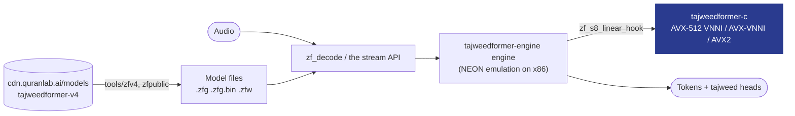

# TajweedFormer for Windows and Linux: reference for coding assistants

Everything an assistant needs to integrate this SDK correctly: use only the names, calls and settings shown here or in the installed version's sources. People: the short version is in [README.md](README.md).

## What you get

<table>
<tr>
<td width="33%" valign="top">

**Hears the recitation**<br>Streaming recognition of Quranic recitation: audio in, and what the model heard comes out as often as every 160 ms (320 ms by default, 480 ms for longer context).

</td>
<td width="33%" valign="top">

**Every output of the model**<br>The sounds it heard with confidence and timing, and every head of the network per chunk (lengthening, gemination, ghunna, qalqalah and more): yours to build on.

</td>
<td width="33%" valign="top">

**Desktops and servers**<br>A C API, a CLI and a server runner for Windows and Linux on x86-64, with int8 kernels for AVX2, AVX-VNNI and AVX-512 VNNI.

</td>
</tr>
<tr>
<td valign="top">

**Private by default**<br>Offline, on the machine it runs on. A recording leaves it only when the learner agrees to share it.

</td>
<td valign="top">

**Nothing to host**<br>The SDK downloads the model (56.5 MB for the default context) from our CDN in six regions and verifies it.

</td>
<td valign="top">

**Tajweed scoring in SDK 2.x**<br>For a known ayah, SDK 2.x also scores the take: letters and vowels, madd held too short or too long, a score for every word. Qalqalah checks are experimental.

</td>
</tr>
</table>

### Tajweed scoring in SDK 2.x

Scoring has four presets. **Strict** almost never flags a correct recitation. **Balanced** is the default. **Sensitive** catches more, and **Very sensitive** catches the most, for a teacher who reviews every flag first. The word level follows your learners: **strict** for huffaz and advanced students, **general** for most apps, **beginner** for children and classes. You set them in the portal and your app picks them up without a new build. Scoring is part of SDK 2.x; SDK 3.0 is inference only, so build new judging on the model's output.

## Why TajweedFormer

- **Made for the Quran.** Trained on Quranic recitation, with its own sound units and heads for what tajweed is about.
- **Feedback in the moment.** Output streams while the learner recites, so your app can respond on the word itself, not after the take.
- **One engine on every platform.** The same engine runs the [Windows and Linux](https://github.com/Quran-Lab/tajweedformer-c), [Android](https://github.com/Quran-Lab/tajweedformer-android), [iOS and macOS](https://github.com/Quran-Lab/tajweedformer-apple) and [web](https://github.com/Quran-Lab/tajweedformer-web) SDKs, all set from one portal.
- **Free, and it stays free.** Quran Lab is a non-profit waqf: the SDKs and models are never sold. The licence, NPL-1.2, asks three things: no paywall on model features, no results presented as rulings, and show the notice.

## Built for AI developers

Copy the setup prompt from [portal.quranlab.ai](https://portal.quranlab.ai) and paste it into your coding assistant. That one prompt sets everything up: the library, your key, and the settings for the learners your app is for. [AGENTS.md](AGENTS.md), beside this README, gives the assistant the complete API, so the code it writes uses names that exist. Prefer to do it by hand? Get a key in the portal and start below.

## At a glance

- **What it is:** the TajweedFormer SDK for Windows and Linux: `tajweedformer.dll` /
  `libtajweedformer.so` (and a static library) with one C header, [`include/tajweedformer.h`](include/tajweedformer.h),
  over the [tajweedformer-engine](https://github.com/Quran-Lab/tajweedformer-engine) engine, plus the
  `tajweedformer` command-line tool and server tier. The engine runs on native int8 kernels (AVX-512 VNNI,
  AVX-VNNI, AVX2, picked at run time).
- **What it gives:** audio in, the model's output out: a verified V4 model folder (signed manifest, every file
  hashed); streams with every head of the network, selectable; the decoded layer (per frame top-1 and runner-up
  with log-probs and margin, tokens with confidence). In SDK 2.x also the tajweed layer for a known ayah (per-site
  verdicts with per-head and fused LLRs, madd counts, qalqalah and gemination evidence, per-word scores) with
  settings resolved app code > portal > calibration.json. And the
  portal client (register, verified config, anonymous telemetry, issues, recitation sharing: see
  [Recitation sharing](#recitation-sharing) and [Telemetry](#telemetry)); resumable model downloads.
- **Model:** TajweedFormer V4 only (`Quran-Lab/tajweedformer-v4`, `sdk/v4.0`; contexts `c16_l64`, `c8_l64`,
  `c24_l72`, `c24_l256`). v3.2 stays on the 1.x SDKs (the `zf_decode` harness here still runs it, for conformance).
- **Who it is for:** desktop apps on Windows and Linux, and servers decoding many recitations.
- **Status:** preview. Through the library's own API on Windows x86-64 (clang on the Microsoft runtime): V4
  conformance 35/35 at all three contexts (all twelve outputs of every chunk, bit for bit), the reference's scorer vectors
  96/96, the settings vectors 39/39, the shared layers vectors 48/48. Linux: built and tested by the CI workflow
  (see [CHANGELOG.md](CHANGELOG.md) for its state). On Windows, clang on the Microsoft runtime is the default
  build: about 1.5x faster than MinGW GCC, the same bits.

## The TajweedFormer SDKs

One model, one engine, the same bits on every platform. Each SDK compiles the same engine source
(Quran-Lab/tajweedformer-engine, pinned as a submodule), so no platform can drift from the others.

| Repository | What it is | Platforms | Install |
| - | - | - | - |
| [tajweedformer-android](https://github.com/Quran-Lab/tajweedformer-android) | Kotlin SDK (AAR) | Android 8.0+ on arm64-v8a and armeabi-v7a, desktop JVM | Maven Central `ai.quranlab:tajweedformer:2.0.2` |
| [tajweedformer-apple](https://github.com/Quran-Lab/tajweedformer-apple) | Swift SDK: Neural Engine (CoreML) with the exact CPU engine as fallback | iOS 15+, macOS 12+, Apple silicon | SwiftPM, `from: "2.0.2"`, product `TajweedFormer` |
| [tajweedformer-web](https://github.com/Quran-Lab/tajweedformer-web) | WebAssembly SDK with SIMD128 | Browsers, Node 20+ | `npm install @quran-lab/tajweedformer` |
| [tajweedformer-c](https://github.com/Quran-Lab/tajweedformer-c) | C API and server runner with x86 int8 kernels (AVX2, AVX-VNNI, AVX-512 VNNI) | Windows, Linux (x86-64) | Build tag 2.0.2 with CMake |
| [tajweedformer-engine](https://github.com/Quran-Lab/tajweedformer-engine) | The engine: exact C runtime, tajweed scorer, conformance suite | everything above | Git submodule |

The model is Quran-Lab/tajweedformer-v4 (`sdk/v4.0`), hosted by Quran Lab and served by
`cdn.quranlab.ai/models` to app keys from [portal.quranlab.ai](https://portal.quranlab.ai).
SDK 2.x runs V4 only.
[portal.quranlab.ai](https://portal.quranlab.ai) is where you create an app, get its developer key,
choose which model revision your users get, and, for SDK 2.x scoring, set the tajweed checks (presets,
per-class thresholds) your users see, without shipping a new build.

## Install

There are no prebuilt binaries: build the release tag with CMake.

```sh
git clone --recurse-submodules --branch 2.0.2 https://github.com/Quran-Lab/tajweedformer-c
cd tajweedformer-c
cmake --preset linux && cmake --build --preset linux                    # Linux
cmake --preset windows-clang && cmake --build --preset windows-clang    # Windows
```

The build leaves the library (`libtajweedformer.so`, or `tajweedformer.dll` with `tajweedformer.lib`) and the `tajweedformer` command-line tool in `build/linux` or `build/windows-clang`. Your program includes `include/tajweedformer.h` and links the library. From the repository's root:

```sh
cc quickstart.c -I include -I vendor/zipformer-sdk/tajweed/include -L build/linux -ltajweedformer -o quickstart                    # Linux
clang quickstart.c -I include -I vendor/zipformer-sdk/tajweed/include -L build/windows-clang -ltajweedformer -o quickstart.exe    # Windows
```

At run time the program needs the library: `LD_LIBRARY_PATH=build/linux` on Linux; on Windows keep `tajweedformer.dll` beside the program or on `PATH`.

## Before you start

| | |
| - | - |
| **Key** | A desktop key from [portal.quranlab.ai](https://portal.quranlab.ai), for your app's id (a reverse-DNS id on Linux, the package family name on Windows). |
| **Systems** | Windows and Linux on x86-64. |
| **Compilers** | Linux: gcc or clang. Windows: LLVM clang on the Microsoft runtime, or MinGW-w64 GCC. Microsoft's `cl.exe` cannot build the engine. CMake 3.24 or later, and Ninja. |
| **Libraries** | Linux: the development files of libcurl and OpenSSL 3 (`libcurl4-openssl-dev libssl-dev` on Debian and Ubuntu). Windows: none. The build downloads libopus 1.6.1 once and checks its hash. |
| **Microphone** | The library takes samples; capturing them is your program's part. The quick start pipes the system's recorder in. |
| **Download** | The model is 56.5 MB for the default context (73.5 MB on disk), downloaded once into a folder you choose; every context together is 58.9 MB. |
| **Streams** | One live stream per process at a time. A server runs one worker process per stream. |

## Quick start

From your key to what the model hears from the microphone. Save this as `quickstart.c` (it is
[`examples/quickstart.c`](examples/quickstart.c), which every build compiles):

```c
#include <stdio.h>
#include <string.h>
#include "tajweedformer.h"
#ifdef _WIN32
#include <fcntl.h>
#include <io.h>
#endif

typedef struct {
  TfModel *model;
  TfStream *stream;
} Take;

static void on_chunk(void *user, const TfChunk *chunk) {   /* every 320 ms of audio: what the model heard so far */
  const Take *take = user;
  TfDecoded *heard = tf_stream_decode(take->stream);
  const TfToken *t;
  const int n = tf_decoded_tokens(heard, &t);
  printf("%6d ms:", chunk->end_ms);
  for (int i = 0; i < n; ++i) printf(" %s", tf_model_token_name(take->model, t[i].id));
  printf("\n");
  fflush(stdout);
  tf_decoded_free(heard);
}

int main(int argc, char **argv) {
  if (argc < 2) return fprintf(stderr, "usage: quickstart qlk_v1_... < mono float samples at 16 kHz\n"), 2;

  /* 1. the key: Quran Lab's signed config names the model revision this app gets */
  TfClientOptions co = tf_client_default_options();
  co.key = argv[1];
  co.app_id = "com.example.quickstart";      /* your app's id, as registered for the key */
  co.app_version = "1.0";
  co.storage_dir = "quranlab";               /* the SDK's own state */
  TfClient *client = tf_client_create(&co);
  if (!client || tf_client_launch(client)) return fprintf(stderr, "portal: %s\n", tf_last_error()), 1;
  const char *config = tf_client_config_json(client);   /* verified; "recommended":{...,"revision":"..."} */
  const char *at = config ? strstr(config, "\"recommended\"") : NULL;
  char revision[80] = "";
  if (at && (at = strstr(at, "\"revision\"")) && (at = strchr(at + 10, '"'))) {
    const size_t len = strcspn(at + 1, "\"");
    if (len < sizeof revision) memcpy(revision, at + 1, len);
  }
  if (!revision[0]) return fprintf(stderr, "the config recommends no model for this key\n"), 1;

  /* 2. the model: downloaded once (56.5 MB), resumed if interrupted, every file checked */
  TfDownloadOptions dl = tf_download_default_options();
  dl.key = argv[1];
  dl.revision = revision;
  dl.dest = "model";
  dl.contexts = "c16_l64";                   /* the default context: 320 ms chunks */
  if (tf_download_model(&dl)) return fprintf(stderr, "download: %s\n", tf_last_error()), 1;
  TfModel *model = tf_model_open("model", NULL);
  if (!model) return fprintf(stderr, "model: %s\n", tf_last_error()), 1;

  /* 3. audio in, model output out */
  Take take = {model, NULL};
  TfStreamOptions so = tf_stream_default_options();
  so.on_chunk = on_chunk;
  so.user = &take;
  take.stream = tf_stream_create(model, &so);
  if (!take.stream) return fprintf(stderr, "stream: %s\n", tf_last_error()), 1;
#ifdef _WIN32
  _setmode(_fileno(stdin), _O_BINARY);
#endif
  float samples[1600];                       /* 100 ms at 16 kHz */
  size_t n;
  while ((n = fread(samples, sizeof *samples, 1600, stdin)) > 0) tf_stream_push_audio(take.stream, samples, (int)n);
  tf_stream_finish(take.stream);             /* the end of the take: the last chunks arrive */

  tf_stream_destroy(take.stream);
  tf_model_close(model);
  tf_client_destroy(client);
  return 0;
}
```

Compile it against the library you built (the two lines under Install), then pipe the microphone in as raw mono
float samples at 16 kHz. Capture is the system's recorder, because it is a platform API this library does not wrap:

```sh
arecord -q -f FLOAT_LE -r 16000 -c 1 -t raw | LD_LIBRARY_PATH=build/linux ./quickstart qlk_v1_...                                  # Linux
ffmpeg -loglevel error -f dshow -i audio="<your microphone>" -ac 1 -ar 16000 -f f32le - | quickstart.exe qlk_v1_...              # Windows
```

(`ffmpeg -list_devices true -f dshow -i dummy` lists the Windows microphones.) The first run downloads the model
into `model/`; later runs only check it. Each line printed is what the model heard so far; `tf_stream_decode` also
gives every token's confidence, runner-up and times, and the chunk carries every head of the network you selected.

In SDK 2.x a finished take of a known ayah can also be scored: `tf_stream_score(stream, surah, ayah)` gives verdicts
per site and per word.

Everything is in [docs/api.md](docs/api.md): settings, head selection, the decoded and tajweed layers, the portal
client, recitation sharing, downloads and the server tier. There are no prebuilt binaries: the library is built
from source.

## How it works



The engine is built by its own CMake, in its exact configuration: the NEON emulation on x86 (the
engine's exact paths exist only in NEON form, `zf/neon_emu.h`), `ZF_QUANT_DIVIDE=1`, and no
floating-point contraction. Every int8 linear and lowered convolution in the engine goes through one
function, which first offers the work to a **weak hook**, `zf_s8_linear_hook`: rows of the shifted
int8 activations against a range of weight panels, written as int32 at a column shift. The engine's
weak default declines; `src/zf_vnni_hook.c` is the strong definition, linked as an object so it wins
the link (`hooked_check` fails if it does not). The hook:

- computes exactly the requested rows and panel range, so it serves the engine's pooled,
  multi-threaded calls as well as single-thread ones;
- builds its own weight layout lazily from the engine's packed panels the first time each weight is
  seen, and caches it for the process (lock-free lookup, locked insert; a fingerprint guards against
  a reused pointer), so any number of streams on any number of threads use it;
- picks the widest tier the CPU and OS support, once (cpuid and xgetbv).

The tiers form the same integer, `sum_k q_k*w_k - zp*sum_k w_k`, which is what the engine's
`sum_k (q_k - zp)*w_k` equals:

| Tier | Instruction | Why it is exact |
| - | - | - |
| AVX-512 VNNI | `VPDPBUSD` zmm, 64 multiply-adds | u8 x s8 into s32, four-way, wrapping, no saturation |
| AVX-VNNI | `VPDPBUSD` ymm (VEX), 32 multiply-adds | the same instruction at 256 bits (Alder Lake and later) |
| AVX2 | `VPMADDUBSW` on \|a\| and sign(w, a), then `VPMADDWD` | a is the engine's shifted int8, so \|a\| <= 128; no weight is -128 (the engine's packer refuses one); a pair is at most 2 x 128 x 127 = 32512, so the int16 step never saturates |
| scalar | C | the same sum |

The float side of the decode (front end, attention, softmax, BiasNorm, the activations) is the
engine's own code, unchanged.

<!-- exactness:begin -->
## Exactness

Bit-exact means the same thing in every Quran Lab TajweedFormer SDK repository. For the same input,
the engine gives the same tokens and the same value, to the last bit, for every output of every
chunk, as ONNX Runtime's ARM int8 reference running the published model. For V4 that is all twelve
outputs (the final CTC log-probs and the eleven tajweed heads) at every shipped context; for v3.2 it
is the log-probs. It is checked on the 35 parity clips of the conformance set (the
`conformance-data-2` release of tajweedformer-engine): the tokens, the chunk count and an FNV-1a
fingerprint of every output of every chunk are compared with the expected files, and one bit of
difference on one clip is a failure. Paths that cannot meet this (the Neural Engine, NPUs, fp16
anywhere) are called approximate, and they are measured against the exact engine, never the other
way round.
<!-- exactness:end -->

### How this repository proves it

Two levels. The kernels against the engine's kernel, on random shapes (`ctest`):

| test | what it proves |
| - | - |
| `vnni_check` | every tier this CPU has equals an independent integer golden (200 shapes), and its single-thread speed |
| `dropin_check` | every tier equals the engine's own `zf_linear_s8` (972 shapes), full width and a pooled sub-range each |
| `hooked_check` | the engine's `zf_linear_s8` and `zf_linear_s8_tile`, through the hook, equal the golden on every tier, and the hook took the calls |
| `validate_against_ort.py` | the kernel equals ONNX Runtime's `MatMulInteger` on real model weights (v3.1; needs the gated model and ORT; not in `ctest`) |

The whole decode against ONNX Runtime: the engine's harnesses are linked with the hook, so the
engine's own conformance scripts run every chunk on the native kernels.

**V4**, `bench/v4_conformance.sh` (tokens, chunk count and all twelve outputs of every chunk), Windows
x86-64, MinGW-w64 GCC 13.2, Intel Core i9-14900KF, tier AVX-VNNI, 2026-11-07 (`ZF_NATIVE_STATS=1`
confirms every int8 call of `zf_set_rt`, `zf_stream_check` and `zf_tajweed_check` ran on the native
tier, none declined):

| Line | `c16_l64` | `c24_l72` | `c24_l256` |
| - | - | - | - |
| `zf_set_rt` (features) | 35/35 | 35/35 | 35/35 |
| stream, 1/7/13/3/29-frame pushes | 35/35 | 35/35 | 35/35 |
| stream, batch 8 | 35/35 | 35/35 | 35/35 |
| stream, audio | 35/35 | | |
| `zf_tajweed.h`, audio | 35/35 | | |

The same eleven lines on the AVX2 tier (`ZF_NATIVE_INT8=avx2`): 35/35 on every line, 0 failing.

`c8_l64` (160 ms) through `tf_stream`, all twelve outputs of every chunk, on the same build and folder: 35/35; its features lines
and the two audio lines of `bench/v4_conformance.sh` are in the engine's branch `v4-c8`, 35/35 each.

**v3.2**, `bench/conformance.sh` (the engine's full matrix: threads, pools, push sizes, batches,
release build, concurrent streams, carried states, hand-over), same machine, tier AVX-VNNI: all 33
lines 35/35, 0 failing.

The clang build on the Microsoft runtime: V4 every line 35/35 except `zf_tajweed.h, audio`, whose
harness the engine does not build for that runtime; v3.2 all 33 lines 35/35.

| Tier | Kernel tests | Whole decode, V4 and v3.2 |
| - | - | - |
| AVX-512 VNNI | **not run in 2.0.0**: compiles; the 1.x kernel passed on a Ryzen 7 9700X (2026-09), the 2.0.0 one adds panel ranges and has never executed | **not run**: no AVX-512 machine available |
| AVX-VNNI | yes (14900KF) | yes, tables above |
| AVX2 | yes (14900KF) | V4: yes, all eleven lines (forced with `ZF_NATIVE_INT8=avx2`) |
| scalar | yes (14900KF) | the engine's own kernel is the reference; `ZF_NATIVE_INT8=off` runs it |
| CUDA `dp4a` | no | no: compiles with nvcc 13.1, never run |

The CUDA tier (`cuda/zf_gemm_cuda.cu`) is a standalone int8 GEMM, not wired into the engine. `dp4a`
is an exact int8 dot, so its matmul can be exact; a full-GPU forward pass would not be (GPU
transcendentals and FMA in the float layers). There is no fp16 tier: fp16 is not bit-exact.

## Performance

Host throughput of the whole decode (audio in, every output of every chunk), `zf_decode --bench` over
the 35 parity clips (182 s of audio, decoded round robin for 60 s, the 1.05 s end-of-utterance flush
of each clip computed but not counted as audio), 8 threads in total per run, int8 on AVX-VNNI. Intel
Core i9-14900KF, Windows 11, 2026-11-07. **The PC was shared and loaded by other work (about 75% CPU
busy before these runs), so the figures are indicative and low.**

| Build | Model | 8 streams x 1 thread, `ZF_PIN=0` | 8 streams x 1 thread, engine default | 1 stream x 8 threads |
| - | - | - | - | - |
| clang, Microsoft runtime | V4 `c16_l64` | **55.6x** real time (7.0x per stream) | 13.8x | 21.6x |
| clang, Microsoft runtime | v3.2 | **58.1x** (7.4x per stream) | 14.3x | 36.8x |
| MinGW-w64 GCC 13.2 | V4 `c16_l64` | **34.7x** (4.4x per stream) | 9.3x | 18.1x |
| MinGW-w64 GCC 13.2 | v3.2 | **38.7x** (4.9x per stream) | 9.7x | 26.4x |

How to read it:

- **Many streams want one thread each and the engine's core pinning off.** Each stream's pool pins its
  calling thread to the fastest core, so eight one-thread streams all land on the same core (the
  "engine default" column). `ZF_PIN=0` turns that off in a development build; a release build ignores
  the environment, so a release server needs an engine-side switch (reported to the engine).
- **V4 at `c16_l64` costs about as much per second of audio as v3.2** with many streams (55.6x against
  58.1x); a single stream on 8 threads is slower for V4 because its 320 ms chunk has less work per
  chunk to split.
- **clang builds the engine about 1.5x faster than MinGW GCC here**, with the same bits (both builds
  pass the conformance sets). For a Windows server, build with clang.
- The int8 matmuls are no longer the bottleneck: with the hook off (`ZF_NATIVE_INT8=off`) a V4 clip
  is only about 10% slower. The rest of a chunk is the engine's float side through the NEON emulation.

The kernels alone, single thread, `vnni_check` (MAC-weighted mix of the model's int8 shapes):

| Device | Tier | Figure | Measured |
| - | - | - | - |
| Core i9-14900KF | AVX-VNNI | 157 GMAC/s on 24x512x512; the mix in 3.5 ms | 2026-11-07 |
| Ryzen 7 9700X | AVX-512 VNNI | 356 GMAC/s; the int8 part of a v3.1 chunk in about 1.3 ms | 2026-09-27 (1.x) |
| Ryzen 7 9700X | WASM SIMD128, for comparison | 51 GMAC/s | 2026-09-27 (1.x) |

## The int8 kernels (internal API)

| Call | What it does |
| - | - |
| `zf_int8_cpu_tier()`, `zf_int8_tier()`, `zf_int8_set_tier(t)` | the best tier the CPU has, the one in use, and a lower one for testing |
| `zf_vnni_packed_bytes(n, k)`, `zf_vnni_row_sums_count(n)` | sizes of the packed weights and their row sums |
| `zf_vnni_pack(w, n, k, packed, row_sums)` | packs an `n x k` int8 weight once, at load |
| `zf_vnni_kpad(k)` | the padded row stride for the activations |
| `zf_vnni_linear_u8(q, m, ldq, packed, row_sums, n, k, a_zero_point, out, ldc)` | the exact int8 linear on uint8 activations |
| `zf_vnni_linear_s8(...)`, `zf_vnni_linear_s8_cols(..., c0, c1, j_shift)` | the same on the engine's shifted int8 activations, all columns or a range |

The header is [`include/zf_gemm_vnni.h`](include/zf_gemm_vnni.h) (and
[`include/zf_gemm_cuda.h`](include/zf_gemm_cuda.h) for the CUDA tier). An application that wants the
engine with the native kernels links the engine's libraries (`zf_stream`, or `zf_tajweed_engine` for
the scorer) together with the `zf_vnni_hook` object and `zf_gemm_vnni`, as `zf_decode` does.

| Environment | Effect |
| - | - |
| `ZF_NATIVE_INT8=off\|scalar\|avx2\|avxvnni\|avx512vnni` | use a lower tier (one the CPU lacks falls back to the best it has); `off` declines every call, so the engine's own kernel runs |
| `ZF_NATIVE_STATS=1` | print, at exit, how many hook calls each tier took |

> **Linking note.** The engine's `kernels.c` defines the hook *weak*, so a strong definition inside a
> static archive is never pulled and the decode silently stays on the engine's kernel. The hook is
> therefore an **object library** (`zf_vnni_hook`), linked into each executable directly. Any consumer
> that wants the native kernels must link it the same way; `ZF_NATIVE_STATS=1` shows whether it did.

## Build from source

The engine sources are pinned as the submodule `vendor/zipformer-sdk` (tajweedformer-engine; the
directory keeps its name).

```bash
git clone --recurse-submodules https://github.com/Quran-Lab/tajweedformer-c
cmake --preset windows-clang && cmake --build --preset windows-clang   # the default on Windows
cmake --preset windows-mingw && cmake --build --preset windows-mingw   # MinGW-w64 GCC, the same bits, slower
cmake --preset linux && cmake --build --preset linux                   # Linux (apt: ninja-build libcurl4-openssl-dev)
bash test/run_tests.sh build/windows-clang <data>                      # the library's tests (data: below)
```

The presets build the release configuration (`ZF_NATIVE_RELEASE`: the engine's exact settings, the `ZF_*`
environment ignored). Outputs: `tajweedformer.dll` + `tajweedformer.lib` (Windows) or `libtajweedformer.so`
(Linux), `tajweedformer_static`, the `tajweedformer` CLI and `tf_tests`. The DLL exports exactly `tf_*`,
`zf_tajweed_*` and `zf_platform_*` (`src/tf/tajweedformer.def`; a version script on Linux).

- **Windows:** LLVM `clang.exe` on the Microsoft runtime (the default), or MinGW-w64 GCC (for example Strawberry Perl's `c\bin`; the binaries need
  `libwinpthread-1.dll` from there on `PATH`), or LLVM `clang.exe` on the Microsoft runtime. MSVC
  `cl.exe` cannot build the engine (GNU vector extensions); see the engine's `docs/windows.md`. No WSL.
- **Ubuntu / Linux:** gcc or clang.
- Each x86 tier is its own translation unit, compiled with its own `-m` flags; the dispatcher and
  everything else stay at the baseline ISA and a run-time check selects the tier, so one binary runs
  on any x86-64.
- Only the engine targets this project uses are built (the engine is added with `EXCLUDE_FROM_ALL`):
  its libraries and the conformance harnesses, each linked with the hook.
- **CUDA (optional):** `-DZF_CUDA=ON` (CUDA toolkit; compute capability 6.1 or later for `dp4a`).

## Verify it yourself

The library's tests (`test/run_tests.sh`): crypto (SHA-2, Ed25519 RFC 8032), folder verification (wrong key,
unsigned, a changed file), V4 conformance through `tf_stream` (35 clips, all twelve outputs of every chunk, the
engine's `v4_c16_l64_audio_expected.jsonl`; chunk-24 contexts against the native reference when given), the
default head selection, the reference's scorer vectors through `tf_score` (the engine's own comparison rules), the typed
sites against the engine's JSON, the shared layers vectors, and the settings
vectors through `tf_settings_*`. The data is the test data release of the development repository, which the CI
workflow downloads and checks by SHA-256.

The engine's own harnesses on the native kernels:

```bash
ctest --test-dir build --output-on-failure      # vnni_check, dropin_check, hooked_check

# the whole decode on the native kernels against the engine's expected outputs
# (data: the conformance-data-2 release of tajweedformer-engine; on Windows from Git Bash)
vendor/zipformer-sdk/bench/v4_conformance.sh build/engine <sdk/v4.0 folder> <data>
vendor/zipformer-sdk/bench/conformance.sh build/engine build-rel/engine <data>
ZF_NATIVE_INT8=avx2 vendor/zipformer-sdk/bench/v4_conformance.sh build/engine <sdk/v4.0 folder> <data>
```

Against ONNX Runtime's `MatMulInteger` on the real weights (v3.1; needs the gated model):

```bash
python3 -m venv .venv && . .venv/bin/activate
pip install numpy onnx onnxruntime
cc -O3 -fPIC -c -Iinclude src/int8_avx512.c -mavx512f -mavx512bw -mavx512vnni
cc -O3 -fPIC -c -Iinclude src/int8_avxvnni.c -mavx2 -mavxvnni
cc -O3 -fPIC -c -Iinclude src/int8_avx2.c -mavx2
cc -O3 -fPIC -shared -Iinclude src/zf_gemm_vnni.c int8_avx512.o int8_avxvnni.o int8_avx2.o -o libzfvnni.so
python3 test/validate_against_ort.py libzfvnni.so zipformer_p_arabic_v3.1.int8.onnx
```

## Recitation sharing

How the SDK talks to Quran Lab, what it sends and when, is in [docs/platform-client.md](docs/platform-client.md) (the
same page in every TajweedFormer SDK); the C calls are in [docs/api.md](docs/api.md).

- **Quran Lab decides whether sharing is offered** to an app, in the signed config it downloads
  (`flags.contributions`); the app's own option is ignored since 2.0.1, and without a config in force nothing is
  offered. Offered is never consent: nothing is recorded or sent before the learner answers "share".
- **The sheet is the app's.** This library has no UI (so nothing to theme): the SDK asks at a good moment through
  the `on_consent` callback (or a pending ask in the status), with the copy deck in the learner's language (deck
  `2026-11-09.1`, consent `share-2026-11-09`, eight languages), and the app reports the learner's tap with
  `tf_client_sharing_answer`. The SDK counts the asks and keeps the re-ask rules.
- **At most three sheets, and a yes is final.** The sheet is shown at most three times per install, ever ("Not
  now" may lead to a later ask, 7 sessions apart; the count carries over from 2.0.0). A learner who answered
  "share" is never asked again: the grant keeps the version they agreed to across copy decks, wording changes and
  upgrades from 2.0.0, and every shared session carries that version. Turning sharing off ends asking too; after
  that only the app's settings switch (`tf_client_sharing_set`) turns sharing on or off.
- **Own wording.** `tf_sharing_set_wording` replaces any deck string. A learner who agrees then agrees to that
  text: the consent version becomes `custom-` plus 24 hex digits of its SHA-256, and every session shared under it
  carries `consent_text_sha256` so Quran Lab can review the wording (`tf_sharing_consent_text` and
  `tf_sharing_consent_sha256` give it to the developer). Learners who agreed before keep their version and are
  not asked again.
- **Bitrate on bad networks.** Opus starts at 192 kbit/s and steps down to 96, 64 and 32 kbit/s when uploads fail
  for network reasons or the queue backs up, and back up when uploads succeed; each segment keeps one bitrate,
  recorded on disk and listed by `tf_sharing_outbox_json`.
- **Stop and delete** at any time (`tf_client_sharing_set(c, 0)`, `tf_client_sharing_delete`), whatever wording the
  learner agreed to.

## Telemetry

Anonymous by construction (sums and histograms per UTC day; no audio, text, identifiers or times finer than the
day), on by default, off with the signed config's `flags.analytics: false` or `TfClientOptions.telemetry =
ZF_ANALYTICS_OFF`. Since 2.0.1 the SDK sends deltas during the day instead of one report the next day: every 15
minutes while a client is open, at `tf_client_background`, at `tf_client_destroy` and at `tf_client_launch`, each
with a random `report_id` so a retry is counted once. New counters: launches, ayahs and words scored, ayahs per
surah, per rule how many verdicts were checked and flagged, and the sharing sheet's asks and answers.
`POST /v1/register` goes out once per UTC day per install. Details: [docs/platform-client.md](docs/platform-client.md).

## Layout

```
include/  zf_gemm_vnni.h      the int8 kernels' API (tiers, packing, linear)
          zf_gemm_cuda.h      the CUDA tier's API
src/      zf_gemm_vnni.c      tier detection and dispatch, packing, the scalar kernel
          int8_avx512.c, int8_avxvnni.c, int8_avx2.c   one x86 tier each, built with its own -m flags
          zf_vnni_hook.c      the engine's zf_s8_linear_hook: weight cache, ranges, threads
include/  tajweedformer.h     the public C API (tf_*), over the engine's zf_tajweed.h
src/tf/   tf_model.c, tf_stream.c, tf_decode.c, tf_score.c   folder verification, settings, streams, layers
          tf_client.c, tf_sharing.c, tf_download.c, tf_http.c   portal client, sharing consent, downloads, HTTP
          tf_crypto.c, tf_util.c, tf_copy_deck.c            SHA-2, Ed25519 verify, JSON; the sharing copy decks
          tf_share.c, tf_share_audio.c, tf_ogg.c   whole-session upload: resampler, Opus, Ogg, outbox, uploader
cmake/    opus.cmake          libopus 1.6.1 (pinned tarball, checked) as a static library
cli/      tajweedformer.c     info, decode, serve, bench (worker processes), download, portal
test/     tf_tests.c, check_outputs.py, run_tests.sh, make_test_folder.py   the library's tests
runner/   zf_decode.c         streaming decoder (internal harness, also runs v3.2); --bench for many streams
cuda/     zf_gemm_cuda.cu     GPU int8 tier (dp4a), compiles, never run
test/     vnni_check.c        every tier == integer golden, and speed
          dropin_check.c      every tier == the engine's own zf_linear_s8 (972 shapes)
          hooked_check.c      the engine's entry points through the hook == golden; the hook took them
          validate_against_ort.py   the kernel == ONNX Runtime's MatMulInteger on real weights
docs/     api.md               the C API, with examples
          platform-client.md   how the SDK talks to Quran Lab (the same page in every SDK)
          engineering-notes.md
vendor/   zipformer-sdk       the engine (tajweedformer-engine), pinned as a submodule
```

## Status and roadmap

Done:

- The engine at tajweedformer-engine de88490 (main, API 3 final with the pinning fix: layout 3 with one shared weight file, the word level, lazy heads, top-2 and top-K, the per-platform pinning default), built in its exact configuration with the native hook;
  V4 (all three contexts, all twelve outputs) and v3.2 bit-exact end to end on Windows x86-64.
- Exact int8 tiers for AVX-512 VNNI, AVX-VNNI and AVX2; a hook that serves pooled and concurrent
  calls; a model-driven runner with a multi-stream benchmark.

Next:

- Run V4 and v3.2 conformance on an AVX-512 VNNI machine (a Zen 4 or Zen 5 server, or Ice Lake and
  later Xeon), and on Linux.
- The float side is now most of a chunk's time on x86 (the NEON emulation). Exact AVX2 forms of its
  hottest loops, each held to the conformance sets, are where the next speed is.
- Run the CUDA tier on a GPU and check it against the CPU kernel; wire it into the hook if it pays.

## Download size

`tf_download_model` fetches the CPU files of the model folder (`sdk/v4.0`, manifest format 3), gzip on the wire,
resumable, every file checked against the signed manifest. Model revision v4.0-2026-11-10: **56.5 MB**
for the default context `c16_l64` alone (`contexts = "c16_l64"`; 73.5 MB on disk), or 58.9 MB
for every context (77.2 MB on disk), which is what a server usually keeps. The optional ONNX Runtime
graphs are not downloaded.

## Licence

Quran Lab is a waqf: the SDKs and the models are free to use and are never sold.

The source code in this repository and the TajweedFormer model weights are released under the
Quran-Lab No-Profit License 1.2 ([NPL-1.2](LICENSE)): use, copy, modify and build on them freely,
but never charge for them, for access to them, or for any feature they power. The weights are not
stored in this repository; Quran Lab hosts them itself and serves them to apps by
`cdn.quranlab.ai/models` under the same licence. Get access at
[portal.quranlab.ai](https://portal.quranlab.ai).

Third-party components keep their own licences, listed in their folders under `third_party/`.
