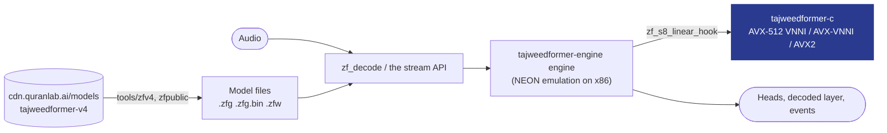

# TajweedFormer for Windows and Linux: reference for coding assistants

Everything an assistant needs to integrate this SDK correctly: use only the names, calls and settings shown here or in the installed version's sources. People: the short version is in [README.md](README.md).

## What you get

<table>
<tr>
<td width="33%" valign="top">

**Hears the recitation**<br>Streaming recognition of Quranic recitation: audio in, and what the model heard comes out as often as every 160 ms (320 ms by default, 480 ms for longer context).

</td>
<td width="33%" valign="top">

**Every output of the model**<br>The sounds it heard with confidence and timing, and every head of the network per chunk (lengthening, gemination, ghunna, qalqalah and more): yours to build on.

</td>
<td width="33%" valign="top">

**Desktops and servers**<br>A C API, a CLI and a server runner for Windows and Linux on x86-64, with int8 kernels for AVX2, AVX-VNNI and AVX-512 VNNI.

</td>
</tr>
<tr>
<td valign="top">

**Private by default**<br>Offline, on the machine it runs on. A recording leaves it only when the learner agrees to share it.

</td>
<td valign="top">

**Nothing to host**<br>The SDK downloads the model (56.5 MB for the default context) from our CDN in six regions and verifies it.

</td>
<td valign="top">

**Data for your own judge**<br>The SDK scores nothing. The model's thresholds and the expected units of each ayah come with it as read-only data, so your app can judge a recitation its own way.

</td>
</tr>
</table>

## Why TajweedFormer

- **Made for the Quran.** Trained on Quranic recitation, with its own sound units and heads for what tajweed is about.
- **Feedback in the moment.** Output streams while the learner recites, so your app can respond on the word itself, not after the take.
- **One engine on every platform.** The same engine runs the [Windows and Linux](https://github.com/Quran-Lab/tajweedformer-c), [Android](https://github.com/Quran-Lab/tajweedformer-android), [iOS and macOS](https://github.com/Quran-Lab/tajweedformer-apple) and [web](https://github.com/Quran-Lab/tajweedformer-web) SDKs, all set from one portal.
- **Free, and it stays free.** Quran Lab is a non-profit waqf: the SDKs and models are never sold. The licence, NPL-1.2, asks three things: no paywall on model features, no results presented as rulings, and show the notice.

## Built for AI developers

Copy the setup prompt from [sdk.quranlab.ai](https://sdk.quranlab.ai) and paste it into your coding assistant. That one prompt sets everything up: the library, your key, and the first calls. [AGENTS.md](AGENTS.md), beside this README, gives the assistant the complete API, so the code it writes uses names that exist. Prefer to do it by hand? Get a key in the portal and start below.

## At a glance

- **What it is:** the TajweedFormer SDK for Windows and Linux: `tajweedformer.dll` /
  `libtajweedformer.so` (and a static library) with one C header, [`include/tajweedformer.h`](include/tajweedformer.h),
  over the [tajweedformer-engine](https://github.com/Quran-Lab/tajweedformer-engine) engine, plus the
  `tajweedformer` command-line tool and server tier. The engine runs on native int8 kernels (AVX-512 VNNI,
  AVX-VNNI, AVX2, picked at run time).
- **What it gives:** a pure inference engine. Audio in, the model's own output out: every head of the network
  (selectable), greedy tokens, the decoded layer (tokens with times, confidence, runner-up and margin; which
  tokens are settled), and events (speech started, speech ended, the take ended). The model's calibration and
  the expected units of each ayah come as read-only data. The SDK never compares a recitation with an expected
  ayah and never says "mistake": a judge is the app's own, built on this output
  ([docs/migrating-to-3.md](docs/migrating-to-3.md)).
- **Five names, the same in every SDK:** Client, Model, Session, Heads, Backend (`TfClient`, `TfModel`,
  `TfSession`, `TfHeads`, `TfBackend`). The Client downloads and verifies the model; a Session is one take.
- **Model:** TajweedFormer V4 (`Quran-Lab/tajweedformer-v4`, `sdk/v4.0`; contexts `c16_l64`, `c8_l64`,
  `c24_l72`, `c24_l256`), addressed by version (`4.0.0`). SDK 3.0.0 runs 3.0 builds; 2.x builds stay on the 2.x
  SDKs.
- **Who it is for:** desktop apps on Windows and Linux, and servers decoding many recitations.
- **Status:** released, 3.1.3. Through the library's own API on Windows x86-64 (clang on the Microsoft runtime): V4
  conformance 35/35 through Sessions (all twelve outputs of every chunk, bit for bit), the shared 3.0 vectors
  (manifest, speech events, settled tokens, telemetry, contexts, names), the error catalogue, and the Model,
  Session and reference tests on a 3.0 model folder. Linux: built and tested by the CI workflow (see
  [CHANGELOG.md](CHANGELOG.md)).

## The TajweedFormer SDKs

One model, one engine, the same bits on every platform. Each SDK compiles the same engine source
(Quran-Lab/tajweedformer-engine, pinned as a submodule), so no platform can drift from the others.

| Repository | What it is | Platforms | Install |
| - | - | - | - |
| [tajweedformer-android](https://github.com/Quran-Lab/tajweedformer-android) | Kotlin SDK (AAR) | Android 8.0+ on arm64-v8a and armeabi-v7a, desktop JVM | Maven Central `ai.quranlab:tajweedformer:3.1.2` |
| [tajweedformer-apple](https://github.com/Quran-Lab/tajweedformer-apple) | Swift SDK: Neural Engine (CoreML) with the exact CPU engine as fallback | iOS 15+, macOS 12+, Apple silicon | SwiftPM, `from: "3.1.3"`, product `TajweedFormer` |
| [tajweedformer-web](https://github.com/Quran-Lab/tajweedformer-web) | WebAssembly SDK with SIMD128 | Browsers, Node 20+ | `npm install @quran-lab/tajweedformer` |
| [tajweedformer-c](https://github.com/Quran-Lab/tajweedformer-c) | C API and server runner with x86 int8 kernels (AVX2, AVX-VNNI, AVX-512 VNNI) | Windows, Linux (x86-64) | CMake `FetchContent`, tag 3.1.3 |
| [tajweedformer-engine](https://github.com/Quran-Lab/tajweedformer-engine) | The engine: exact C runtime, inference library, conformance suite | everything above | Git submodule |

The model is Quran-Lab/tajweedformer-v4 (`sdk/v4.0`), hosted by Quran Lab and served by
`cdn.quranlab.ai/models` to app keys from [sdk.quranlab.ai](https://sdk.quranlab.ai).
SDK 2.x runs V4 only.
[sdk.quranlab.ai](https://sdk.quranlab.ai) is where you create an app, get its developer key,
choose which model revision your users get, and, for SDK 2.x scoring, set the tajweed checks (presets,
per-class thresholds) your users see, without shipping a new build.

## Install

There are no prebuilt binaries: CMake builds the release tag inside your own project. `CMakeLists.txt`:

```cmake
cmake_minimum_required(VERSION 3.24)
project(app C CXX)

include(FetchContent)
FetchContent_Declare(tajweedformer
  GIT_REPOSITORY https://github.com/Quran-Lab/tajweedformer-c.git
  GIT_TAG        3.1.3)
FetchContent_MakeAvailable(tajweedformer)

add_executable(quickstart quickstart.c)
target_link_libraries(quickstart PRIVATE tajweedformer)
if(WIN32)   # the library beside the program
  add_custom_command(TARGET quickstart POST_BUILD COMMAND ${CMAKE_COMMAND} -E copy_if_different
    $<TARGET_RUNTIME_DLLS:quickstart> $<TARGET_FILE_DIR:quickstart> COMMAND_EXPAND_LISTS)
endif()
```

```sh
cmake -B build -G Ninja -DCMAKE_BUILD_TYPE=Release                                                         # Linux
cmake -B build -G Ninja -DCMAKE_BUILD_TYPE=Release -DCMAKE_C_COMPILER=clang -DCMAKE_CXX_COMPILER=clang++     # Windows
cmake --build build
```

To build the repository by itself (the library, the `tajweedformer` command-line tool and the tests), clone it with `git clone --recurse-submodules --branch 3.1.3 https://github.com/Quran-Lab/tajweedformer-c`, then `cmake --preset linux` or `cmake --preset windows-clang`, and `cmake --build --preset` with the same name.

## Before you start

| | |
| - | - |
| **Key** | A desktop key from [sdk.quranlab.ai](https://sdk.quranlab.ai), for your app's id (a reverse-DNS id on Linux, the package family name on Windows). |
| **Systems** | Windows and Linux on x86-64. |
| **Compilers** | Linux: gcc or clang. Windows: LLVM clang on the Microsoft runtime, or MinGW-w64 GCC. Microsoft's `cl.exe` cannot build the engine. CMake 3.24 or later, and Ninja. |
| **Libraries** | Linux: the development files of libcurl and OpenSSL 3 (`libcurl4-openssl-dev libssl-dev` on Debian and Ubuntu). Windows: none. The build downloads libopus 1.6.1 once and checks its hash. |
| **Microphone** | The library takes samples; capturing them is your program's part. The quick start pipes the system's recorder in. |
| **Download** | The model is 56.5 MB for the default context (73.5 MB on disk), downloaded once by `tf_client_model` into the SDK's folder; every context together is 58.9 MB. |
| **Takes** | One Client per process, and one take at a time. A server runs one worker process per take. |

## Quick start

From your key to what the model hears. The code is the marked region of
[`examples/quickstart.c`](examples/quickstart.c), which every build of this repository compiles (the file around it
has the includes and `main`):

```c
static void on_chunk(void *user, const TfChunk *chunk) { (void)user, puts(chunk->decoded->text); }

static int recite(const char *key) {
  TfClient *client = tf_client_create(&(TfClientOptions){.key = key, .app_id = "com.example.quickstart"});
  TfModel *model = tf_client_model(client, NULL);
  TfSession *session = tf_session_create(model, &(TfSessionOptions){.on_chunk = on_chunk, .end_on_silence_ms = 1500});
  float samples[1600];
  for (size_t n; (n = fread(samples, sizeof *samples, 1600, stdin)) > 0 && tf_session_push(session, samples, (int)n) >= 0;) {}
  return tf_session_finish(session);
}
```

Put your app's id where the example says `com.example.quickstart`: a key works for the first app id that used
it. `tf_client_model` downloads the model once, verifies every file, opens it and
warms the engine. Each chunk (320 ms of audio) prints what the model heard so far; the take ends by itself after
1.5 s of silence following speech (`end_on_silence_ms`). In a noisy room a take may not end on silence, so keep
a way to stop (here the end of the input; an app calls `tf_session_finish`); the 20-minute limit ends it in any
case. Values under 1000 can end a take in a breath pause between two words. A call on a NULL object fails and keeps the first error, so one check at the
end is enough: `tf_last_error()`, `tf_last_error_fix()` and `tf_error_docs()` say what went wrong and what to do.

This library has no microphone: pipe the system's recorder in as raw mono float samples at 16 kHz.

```sh
arecord -q -f FLOAT_LE -r 16000 -c 1 -t raw | ./build/quickstart qlk_v1_...                                                       # Linux
ffmpeg -loglevel error -f dshow -i audio="<your microphone>" -ac 1 -ar 16000 -f f32le - | build\quickstart.exe qlk_v1_...        # Windows
```

(`ffmpeg -list_devices true -f dshow -i dummy` lists the Windows microphones.)

The example app is that same file, one console program to read in one sitting. It shows, in this order: the
model loading with the download's progress (`tf_client_prefetch`), a sample clip that ships with the model
played through `tf_session_listen` (output with no microphone), reciting from standard input take after take,
the tokens heard so far with the tentative ones in brackets (`settled`), and the diagnose report.
`quickstart qlk_v1_... --quick` runs only the ten lines above. `examples/CMakeLists.txt` builds it as its own
project.

Everything is in [docs/api.md](docs/api.md); an app coming from 2.x reads
[docs/migrating-to-3.md](docs/migrating-to-3.md). There are no prebuilt binaries: the library is built from source.

## What the SDK gives

- **Chunks.** While audio comes in, `on_chunk` gets each chunk as it is ready: its Heads, whether it holds
  speech, and the decoded layer of the take so far.
- **Heads.** The raw output of the network, per chunk and for the whole take (`tf_session_heads`): the final CTC
  log-probs, two intermediate CTC heads, the identity and timing heads, and the attribute heads (gemination,
  tafkheem, ghunna, qalqalah, face, boundary, confidence). `TfSessionOptions.heads` selects them; a head not asked
  for is not computed.
- **The decoded layer.** What the model heard, ready to show: tokens with their times, confidence, runner-up and
  margin, words, per-frame top-1 and runner-up, and with `top_k` the best K tokens of every frame. `settled`
  says how many tokens will not change any more in this take; `is_final` marks the last one.
- **Events.** `speechStarted`, `speechEnded` and `ended`, from what the model heard. A held sound (a long madd)
  is speech: the timing head keeps hearing it while the token head shows blank. With `end_on_silence_ms` (500
  to 60000) a take ends by itself when the learner stops. In a noisy room a take may not end on silence, so
  keep a way to stop (the app finishes the Session with `tf_session_finish`); the 20-minute limit ends it in
  any case. Values under 1000 can end a take in a breath pause between two words; the quick start uses 1500;
  the minimum is 500.
- **One report for support.** `tf_client_diagnose_json`: SDK, key, config, model, context, backend, storage, the
  last error and the protocol of the last model download, with nothing private in it.

## Calibration and reference data

Two files of the model come as read-only data, for an app that builds its own judge. The SDK applies neither.

- **The calibration** (`tf_model_calibration_json`, `tf_model_calibration_number`): the thresholds Quran Lab
  measured on the heads. Per context: for each class of mistake (`vowel_sub`, `vowel_del`, `vowel_ins`,
  `short_to_long`, `long_to_short`, `cons_sub`, `cons_del`, `insertion`) a threshold per preset (`strict`,
  `balanced`, `sensitive`, `very_sensitive`) on a log-likelihood ratio between the expected sequence and its best
  single-unit alternative, fused from `log_probs` and `inter1_log_probs`; the cuts for madd length on
  `timing_log_probs`; the taus for qalqalah and gemination on `attr_qalqalah` and `gem`; and the word level.
- **The reference data** (`tf_model_reference`, `tf_reference_fetch`, `tf_reference_units`): the expected units of
  every ayah as token ids of the model's vocabulary, with the word of each unit. Downloaded only when the app
  asks.

How the 2.x scorer used them, step by step: [docs/migrating-to-3.md](docs/migrating-to-3.md).

## Running in an app

- **One Client per process, created early.** `tf_client_create` never waits for the network. Call
  `tf_client_prefetch` or `tf_client_model` at start so the model is there before the first take. The
  `unmetered_only` option of `tf_client_prefetch` cannot be honoured here: this library cannot tell what kind of
  connection the machine has (the diagnose report says `"connection": "unknown"`), so the download goes ahead.
- **Without a network** a model the Client downloaded runs; a first run without one is `needs_connection`.
- **On a poor connection** the download goes on by itself: a file whose transfer breaks, or brings no byte for
  30 seconds, is resumed from the bytes on disk, up to five times with a growing pause, before the call fails
  with `download_failed`; the next call goes on from the same bytes. A slow link that keeps delivering is never
  cut. `tf_client_destroy` from another thread ends a download in flight.
- **The model comes from Quran Lab's server, through the Client.** No call opens a model folder of the app's own,
  and a model folder put into the Client's storage by anything but the Client itself is deleted and downloaded
  (the Client keeps a record of its own downloads that is bound to this machine and user: on Windows a key
  protected with DPAPI; on Linux a key derived from the machine id and the user id, or, on a machine without a
  machine id, a key file in the storage folder). After an update from an earlier SDK the model is downloaded
  once more.
- **When Quran Lab refuses the key or the app** (a revoked key, a paused or blocked app), the SDK stops running
  the model and removes the downloaded model from the device. Once the key is accepted again the model is
  downloaded again. Until then `tf_client_model` and `tf_client_prefetch` fail with that refusal, without a
  network too. A Model that is already open keeps running until it is closed; its files are removed when it is
  closed, or at the next start. The sharing state and recordings that are not sent yet are not touched. On
  this platform nothing of the model stays behind: the library keeps a model only in the Client's storage
  folder and has no cache of its own anywhere else.
- **A Session is one take.** For the next take create a new Session of the same Model (one line). A Model has
  one open Session, and a process runs one take at a time: a server runs one process per take
  (`tajweedformer serve`), each with its own storage folder.
- **Leaving and returning.** Call `tf_client_background` when the app is minimized or about to sleep (it sends
  the telemetry counted so far and closes the shared recording) and `tf_client_foreground` when it returns, then
  start a new take.
- **The app's id.** `TfClientOptions.app_id` is the id the key was made for at sdk.quranlab.ai: the package
  family name or AppUserModelID on Windows, a reverse-DNS id on Linux. A key works for the first app id that
  used it: another id gets `server_rejected` with "This key belongs to another app" and the fix (a key for
  this app, or this id allowed on the key's page). The quick start registers `com.example.quickstart`, so give
  it a key of its own or put your app's id there.
- **Storage.** `TfClientOptions.storage` is a folder the app can write; `tf_client_storage_json` says what the
  SDK holds there and `tf_client_remove_models` frees the model files.
- **Memory.** A Session keeps no audio. A take's Heads grow with its length (they are its output); end a take
  when the learner stops, which `end_on_silence_ms` does by itself.

## How it works



The engine is built by its own CMake, in its exact configuration: the NEON emulation on x86 (the
engine's exact paths exist only in NEON form, `zf/neon_emu.h`), `ZF_QUANT_DIVIDE=1`, and no
floating-point contraction. Every int8 linear and lowered convolution in the engine goes through one
function, which first offers the work to a **weak hook**, `zf_s8_linear_hook`: rows of the shifted
int8 activations against a range of weight panels, written as int32 at a column shift. The engine's
weak default declines; `src/zf_vnni_hook.c` is the strong definition, linked as an object so it wins
the link (`hooked_check` fails if it does not). The hook:

- computes exactly the requested rows and panel range, so it serves the engine's pooled,
  multi-threaded calls as well as single-thread ones;
- builds its own weight layout lazily from the engine's packed panels the first time each weight is
  seen, and caches it for the process (lock-free lookup, locked insert; a fingerprint guards against
  a reused pointer), so any number of streams on any number of threads use it;
- picks the widest tier the CPU and OS support, once (cpuid and xgetbv).

The tiers form the same integer, `sum_k q_k*w_k - zp*sum_k w_k`, which is what the engine's
`sum_k (q_k - zp)*w_k` equals:

| Tier | Instruction | Why it is exact |
| - | - | - |
| AVX-512 VNNI | `VPDPBUSD` zmm, 64 multiply-adds | u8 x s8 into s32, four-way, wrapping, no saturation |
| AVX-VNNI | `VPDPBUSD` ymm (VEX), 32 multiply-adds | the same instruction at 256 bits (Alder Lake and later) |
| AVX2 | `VPMADDUBSW` on \|a\| and sign(w, a), then `VPMADDWD` | a is the engine's shifted int8, so \|a\| <= 128; no weight is -128 (the engine's packer refuses one); a pair is at most 2 x 128 x 127 = 32512, so the int16 step never saturates |
| scalar | C | the same sum |

The float side of the decode (front end, attention, softmax, BiasNorm, the activations) is the
engine's own code, unchanged.

<!-- exactness:begin -->
## Exactness

Bit-exact means the same thing in every Quran Lab TajweedFormer SDK repository. For the same input,
the engine gives the same tokens and the same value, to the last bit, for every output of every
chunk, as ONNX Runtime's ARM int8 reference running the published model. For V4 that is all twelve
outputs (the final CTC log-probs and the eleven tajweed heads) at every shipped context; for v3.2 it
is the log-probs. It is checked on the 35 parity clips of the conformance set (the
`conformance-data-2` release of tajweedformer-engine): the tokens, the chunk count and an FNV-1a
fingerprint of every output of every chunk are compared with the expected files, and one bit of
difference on one clip is a failure. Paths that cannot meet this (the Neural Engine, NPUs, fp16
anywhere) are called approximate, and they are measured against the exact engine, never the other
way round.
<!-- exactness:end -->

### How this repository proves it

Two levels. The kernels against the engine's kernel, on random shapes (`ctest`):

| test | what it proves |
| - | - |
| `vnni_check` | every tier this CPU has equals an independent integer golden (200 shapes), and its single-thread speed |
| `dropin_check` | every tier equals the engine's own `zf_linear_s8` (972 shapes), full width and a pooled sub-range each |
| `hooked_check` | the engine's `zf_linear_s8` and `zf_linear_s8_tile`, through the hook, equal the golden on every tier, and the hook took the calls |
| `validate_against_ort.py` | the kernel equals ONNX Runtime's `MatMulInteger` on real model weights (v3.1; needs the gated model and ORT; not in `ctest`) |

The whole decode against ONNX Runtime: the engine's harnesses are linked with the hook, so the
engine's own conformance scripts run every chunk on the native kernels.

**V4**, `bench/v4_conformance.sh` (tokens, chunk count and all twelve outputs of every chunk), Windows
x86-64, MinGW-w64 GCC 13.2, Intel Core i9-14900KF, tier AVX-VNNI, 2026-11-07 (`ZF_NATIVE_STATS=1`
confirms every int8 call of `zf_set_rt`, `zf_stream_check` and `zf_tajweed_check` ran on the native
tier, none declined):

| Line | `c16_l64` | `c24_l72` | `c24_l256` |
| - | - | - | - |
| `zf_set_rt` (features) | 35/35 | 35/35 | 35/35 |
| stream, 1/7/13/3/29-frame pushes | 35/35 | 35/35 | 35/35 |
| stream, batch 8 | 35/35 | 35/35 | 35/35 |
| stream, audio | 35/35 | | |
| `zf_tajweed.h`, audio | 35/35 | | |

The same eleven lines on the AVX2 tier (`ZF_NATIVE_INT8=avx2`): 35/35 on every line, 0 failing.

`c8_l64` (160 ms) through a Session, all twelve outputs of every chunk, on the same build and folder: 35/35; its features lines
and the two audio lines of `bench/v4_conformance.sh` are in the engine's branch `v4-c8`, 35/35 each.

**v3.2**, `bench/conformance.sh` (the engine's full matrix: threads, pools, push sizes, batches,
release build, concurrent streams, carried states, hand-over), same machine, tier AVX-VNNI: all 33
lines 35/35, 0 failing.

The clang build on the Microsoft runtime: V4 every line 35/35 except `zf_tajweed.h, audio`, whose
harness the engine does not build for that runtime; v3.2 all 33 lines 35/35.

| Tier | Kernel tests | Whole decode, V4 and v3.2 |
| - | - | - |
| AVX-512 VNNI | **not run in 2.0.0**: compiles; the 1.x kernel passed on a Ryzen 7 9700X (2026-09), the 2.0.0 one adds panel ranges and has never executed | **not run**: no AVX-512 machine available |
| AVX-VNNI | yes (14900KF) | yes, tables above |
| AVX2 | yes (14900KF) | V4: yes, all eleven lines (forced with `ZF_NATIVE_INT8=avx2`) |
| scalar | yes (14900KF) | the engine's own kernel is the reference; `ZF_NATIVE_INT8=off` runs it |
| CUDA `dp4a` | no | no: compiles with nvcc 13.1, never run |

The CUDA tier (`cuda/zf_gemm_cuda.cu`) is a standalone int8 GEMM, not wired into the engine. `dp4a`
is an exact int8 dot, so its matmul can be exact; a full-GPU forward pass would not be (GPU
transcendentals and FMA in the float layers). There is no fp16 tier: fp16 is not bit-exact.

## Performance

Host throughput of the whole decode (audio in, every output of every chunk), `zf_decode --bench` over
the 35 parity clips (182 s of audio, decoded round robin for 60 s, the 1.05 s end-of-utterance flush
of each clip computed but not counted as audio), 8 threads in total per run, int8 on AVX-VNNI. Intel
Core i9-14900KF, Windows 11, 2026-11-07. **The PC was shared and loaded by other work (about 75% CPU
busy before these runs), so the figures are indicative and low.**

| Build | Model | 8 streams x 1 thread, `ZF_PIN=0` | 8 streams x 1 thread, engine default | 1 stream x 8 threads |
| - | - | - | - | - |
| clang, Microsoft runtime | V4 `c16_l64` | **55.6x** real time (7.0x per stream) | 13.8x | 21.6x |
| clang, Microsoft runtime | v3.2 | **58.1x** (7.4x per stream) | 14.3x | 36.8x |
| MinGW-w64 GCC 13.2 | V4 `c16_l64` | **34.7x** (4.4x per stream) | 9.3x | 18.1x |
| MinGW-w64 GCC 13.2 | v3.2 | **38.7x** (4.9x per stream) | 9.7x | 26.4x |

How to read it:

- **Many streams want one thread each and the engine's core pinning off.** Each stream's pool pins its
  calling thread to the fastest core, so eight one-thread streams all land on the same core (the
  "engine default" column). `ZF_PIN=0` turns that off in a development build; a release build ignores
  the environment, so a release server needs an engine-side switch (reported to the engine).
- **V4 at `c16_l64` costs about as much per second of audio as v3.2** with many streams (55.6x against
  58.1x); a single stream on 8 threads is slower for V4 because its 320 ms chunk has less work per
  chunk to split.
- **clang builds the engine about 1.5x faster than MinGW GCC here**, with the same bits (both builds
  pass the conformance sets). For a Windows server, build with clang.
- The int8 matmuls are no longer the bottleneck: with the hook off (`ZF_NATIVE_INT8=off`) a V4 clip
  is only about 10% slower. The rest of a chunk is the engine's float side through the NEON emulation.

The kernels alone, single thread, `vnni_check` (MAC-weighted mix of the model's int8 shapes):

| Device | Tier | Figure | Measured |
| - | - | - | - |
| Core i9-14900KF | AVX-VNNI | 157 GMAC/s on 24x512x512; the mix in 3.5 ms | 2026-11-07 |
| Ryzen 7 9700X | AVX-512 VNNI | 356 GMAC/s; the int8 part of a v3.1 chunk in about 1.3 ms | 2026-09-27 (1.x) |
| Ryzen 7 9700X | WASM SIMD128, for comparison | 51 GMAC/s | 2026-09-27 (1.x) |

## The int8 kernels (internal API)

| Call | What it does |
| - | - |
| `zf_int8_cpu_tier()`, `zf_int8_tier()`, `zf_int8_set_tier(t)` | the best tier the CPU has, the one in use, and a lower one for testing |
| `zf_vnni_packed_bytes(n, k)`, `zf_vnni_row_sums_count(n)` | sizes of the packed weights and their row sums |
| `zf_vnni_pack(w, n, k, packed, row_sums)` | packs an `n x k` int8 weight once, at load |
| `zf_vnni_kpad(k)` | the padded row stride for the activations |
| `zf_vnni_linear_u8(q, m, ldq, packed, row_sums, n, k, a_zero_point, out, ldc)` | the exact int8 linear on uint8 activations |
| `zf_vnni_linear_s8(...)`, `zf_vnni_linear_s8_cols(..., c0, c1, j_shift)` | the same on the engine's shifted int8 activations, all columns or a range |

The header is [`include/zf_gemm_vnni.h`](include/zf_gemm_vnni.h) (and
[`include/zf_gemm_cuda.h`](include/zf_gemm_cuda.h) for the CUDA tier). An application that wants the
engine with the native kernels links the engine's library `zf_stream` together with the `zf_vnni_hook`
object and `zf_gemm_vnni`, as the repository's own harness `zf_decode` does.

| Environment | Effect |
| - | - |
| `ZF_NATIVE_INT8=off\|scalar\|avx2\|avxvnni\|avx512vnni` | use a lower tier (one the CPU lacks falls back to the best it has); `off` declines every call, so the engine's own kernel runs |
| `ZF_NATIVE_STATS=1` | print, at exit, how many hook calls each tier took |

> **Linking note.** The engine's `kernels.c` defines the hook *weak*, so a strong definition inside a
> static archive is never pulled and the decode silently stays on the engine's kernel. The hook is
> therefore an **object library** (`zf_vnni_hook`), linked into each executable directly. Any consumer
> that wants the native kernels must link it the same way; `ZF_NATIVE_STATS=1` shows whether it did.

## Build from source

The engine sources are pinned as the submodule `vendor/zipformer-sdk` (tajweedformer-engine; the
directory keeps its name).

```bash
git clone --recurse-submodules https://github.com/Quran-Lab/tajweedformer-c
cmake --preset windows-clang && cmake --build --preset windows-clang   # the default on Windows
cmake --preset windows-mingw && cmake --build --preset windows-mingw   # MinGW-w64 GCC, the same bits, slower
cmake --preset linux && cmake --build --preset linux                   # Linux (apt: ninja-build libcurl4-openssl-dev)
bash test/run_tests.sh build/windows-clang <data>                      # the library's tests (data: below)
```

The presets build the release configuration (`ZF_NATIVE_RELEASE`: the engine's exact settings, the `ZF_*`
environment ignored). Outputs: `tajweedformer.dll` + `tajweedformer.lib` (Windows) or `libtajweedformer.so`
(Linux), `tajweedformer_static`, the `tajweedformer` CLI, `quickstart` and `tf_tests`. The shared library exports
exactly the functions of `include/tajweedformer.h` (`src/tf/tajweedformer.def`; a version script on Linux).

- **Windows:** LLVM `clang.exe` on the Microsoft runtime (the default), or MinGW-w64 GCC (for example Strawberry Perl's `c\bin`; the binaries need
  `libwinpthread-1.dll` from there on `PATH`), or LLVM `clang.exe` on the Microsoft runtime. MSVC
  `cl.exe` cannot build the engine (GNU vector extensions); see the engine's `docs/windows.md`. No WSL.
- **Ubuntu / Linux:** gcc or clang.
- Each x86 tier is its own translation unit, compiled with its own `-m` flags; the dispatcher and
  everything else stay at the baseline ISA and a run-time check selects the tier, so one binary runs
  on any x86-64.
- Only the engine targets this project uses are built (the engine is added with `EXCLUDE_FROM_ALL`):
  its libraries and the conformance harnesses, each linked with the hook.
- **CUDA (optional):** `-DZF_CUDA=ON` (CUDA toolkit; compute capability 6.1 or later for `dp4a`).

## Verify it yourself

The library's tests. `ctest` runs what needs no model data: the error catalogue (the embedded copy against the
shared one), the shared 3.0 vectors (manifest acceptance, speech events, settled tokens, telemetry, contexts,
names), the public Client against a stub server (one per process, options, storage, diagnose), sharing, uploads,
consent, telemetry deltas, `test/api_scan.py` (the header, the exports and docs/api.md name the same surface) and
`test/quickstart_check.py`. `test/run_tests.sh` adds the model: crypto (SHA-2, Ed25519 RFC 8032), folder
verification (wrong key, unsigned, a changed file), V4 conformance through a Session per clip (35 clips, all
twelve outputs of every chunk, the engine's `v4_c16_l64_audio_expected.jsonl`; other contexts against the native
reference when given), the default head selection, the decoded layer against the shared layers vectors, and on a
3.0 model folder the Model, Session, listen, reference and download tests. Every test has a time limit and the
test program caps its own memory at 2 GB. No CI runner has a model: the model-backed part runs where the model
folders are, as one bounded command, `python test/local_proof.py <build dir>` (the 35 conformance clips bit for bit
through the Session API, every sample clip through `tf_session_listen`, and top-K on those clips); it skips
cleanly elsewhere.

What the public CI covers, and what it does not. On every push it builds the library on Linux and on Windows and
runs `ctest`: the kernels against the engine's own, and everything above that needs no model. That includes the
ranking behind `top_k`, on the 26 shared rows of `topk.json` (ties, a flat row, a margin a float cannot hold),
compared exactly. It does NOT run, because no runner has the model: the whole decode on the conformance clips;
the sample clips through `tf_session_listen`; `top_k` on real takes (the 35 clips at `c16_l64` and `c8_l64`
against the shared `topk_takes.json`); the download from a CDN with the real manifest. Those four are the local
proof above, run before every release on a machine with the model. It also does not run the AVX-512 VNNI tier
(no runner and no machine here has one; the table under Exactness says what was run where), and it runs no
sanitizer or fuzzer on the parsers.

The engine's own harnesses on the native kernels:

```bash
ctest --test-dir build --output-on-failure      # vnni_check, dropin_check, hooked_check

# the whole decode on the native kernels against the engine's expected outputs
# (data: the conformance-data-2 release of tajweedformer-engine; on Windows from Git Bash)
vendor/zipformer-sdk/bench/v4_conformance.sh build/engine <sdk/v4.0 folder> <data>
vendor/zipformer-sdk/bench/conformance.sh build/engine build-rel/engine <data>
ZF_NATIVE_INT8=avx2 vendor/zipformer-sdk/bench/v4_conformance.sh build/engine <sdk/v4.0 folder> <data>
```

Against ONNX Runtime's `MatMulInteger` on the real weights (v3.1; needs the gated model):

```bash
python3 -m venv .venv && . .venv/bin/activate
pip install numpy onnx onnxruntime
cc -O3 -fPIC -c -Iinclude src/int8_avx512.c -mavx512f -mavx512bw -mavx512vnni
cc -O3 -fPIC -c -Iinclude src/int8_avxvnni.c -mavx2 -mavxvnni
cc -O3 -fPIC -c -Iinclude src/int8_avx2.c -mavx2
cc -O3 -fPIC -shared -Iinclude src/zf_gemm_vnni.c int8_avx512.o int8_avxvnni.o int8_avx2.o -o libzfvnni.so
python3 test/validate_against_ort.py libzfvnni.so zipformer_p_arabic_v3.1.int8.onnx
```

## Recitation sharing

How the SDK talks to Quran Lab, what it sends and when, is in [docs/platform-client.md](docs/platform-client.md) (the
same page in every TajweedFormer SDK); the C calls are in [docs/api.md](docs/api.md).

- **Quran Lab decides whether sharing is offered** to an app, in the signed config it downloads
  (`flags.contributions`); without a config in force nothing is offered. Offered is never consent: nothing is
  recorded or sent before the learner answers "share".
- **The sheet is the app's.** This library has no UI: the SDK asks at a good moment through the `on_consent`
  callback (or `pending_ask` in `tf_sharing_status`), with the copy deck in the learner's language (deck
  `2026-11-13.1`, consent `share-2026-11-09`, eight languages), and the app reports the learner's tap with
  `tf_sharing_answer`. The SDK counts the asks and keeps the re-ask rules.
- **At most three sheets, and a yes is final.** The sheet is shown at most three times per install, ever. A
  learner who answered "share" is never asked again: the grant keeps the version they agreed to across copy
  decks, wording changes and SDK upgrades, and every shared recording carries that version. After that only the
  app's settings switch (`tf_sharing_set_on`) turns sharing on or off.
- **What is shared.** Every take of a Session whose Model came from `tf_client_model`, in full, as Ogg Opus, from
  an on-disk queue that survives restarts (`tf_sharing_items_json`).
- **Own wording.** `tf_sharing_set_wording` replaces any deck string. A learner who agrees then agrees to that
  text: the consent version becomes `custom-` plus 24 hex digits of its SHA-256, and every recording shared under
  it carries `consent_text_sha256` so Quran Lab can review the wording (`TfSharing.consent_text` and
  `consent_sha256` give it to the developer).
- **Bitrate on bad networks.** Opus starts at 192 kbit/s and steps down to 96, 64 and 32 kbit/s when uploads fail
  for network reasons or the queue backs up, and back up when uploads succeed; each segment keeps one bitrate.
- **Takes in a row are one recording.** When a take ends, the shared recording stays open for a few seconds (3 s,
  or what the signed config's `flags.share_join_ms` sets): a take that starts in that time with the same sample
  rate continues the same Ogg stream. The recording closes when no take follows in time, at
  `tf_client_background`, when sharing is turned off, after 20 minutes, or when the next take has another sample
  rate. For a recording of several takes the SDK then sends where each take starts and how long the pause before
  it was.
- **Recordings that do not cut speech.** An app that already captures audio outside takes hands it to
  `tf_sharing_feed`: the last second before a take and the half second after it go into the recording. The SDK
  keeps that second in memory only, drops the feed at once without a yes, and the model never sees it. An app
  that captures only during takes gets no pre-roll and no tail.
- **Stop and delete** at any time (`tf_sharing_set_on(client, 0)`, `tf_sharing_delete`), whatever wording the
  learner agreed to. Both stop an upload that is in flight: the request is aborted and the SDK hands nothing more
  to the system once the call has returned (what the system had already buffered may still go out, which can be
  the segment being sent), the call returns within 3 seconds, and nothing unsent stays on disk. A deletion the server
  took also turns sharing off (the learner turns it on again with the switch and is not asked again); one the
  server did not take changes nothing.

## Telemetry

Anonymous by construction (sums and histograms per UTC day; no audio, text, identifiers or times finer than the
day), on by default, off with the signed config's `flags.analytics: false` or `TfClientOptions.analytics =
TF_ANALYTICS_OFF`. The SDK sends deltas during the day: every 15 minutes while a client is open, at
`tf_client_background` and at `tf_client_destroy`, each with a random `report_id` so a retry is counted once. It
counts what it sees itself: launches, sessions and takes, seconds of audio, of speech and of silence, compute
time, tokens per head, per model version, build, context and backend, and the sharing sheet's asks and answers.
What only the app knows it reports, as counts: `tf_session_report_recited` (which ayahs a take covered) and
`tf_client_report_checks` (how many sites the app's own judge checked and flagged, per rule). Nothing is sent
for them when the app never calls them. `POST /v1/register` goes out once per UTC day per install. Details:
[docs/platform-client.md](docs/platform-client.md).

## Layout

```
include/  tajweedformer.h     the public C API (tf_ names only; no engine type)
          zf_gemm_vnni.h      the int8 kernels' API (tiers, packing, linear)
          zf_gemm_cuda.h      the CUDA tier's API
src/      zf_gemm_vnni.c      tier detection and dispatch, packing, the scalar kernel
          int8_avx512.c, int8_avxvnni.c, int8_avx2.c   one x86 tier each, built with its own -m flags
          zf_vnni_hook.c      the engine's zf_s8_linear_hook: weight cache, ranges, threads
src/tf/   tf_api.c            the public Client: one per process, model, prefetch, storage, diagnose
          tf_model.c, tf_store.c, tf_download.c, tf_reference.c   manifest and folder verification, the model
                              store by build, downloads, the reference data
          tf_session.c, tf_speech.c, tf_heads.c, tf_decode.c, tf_topk.c   a take, speech events, Heads, the
                              decoded layer
          tf_client.c, tf_sharing.c, tf_http.c   registration, the signed config, telemetry, consent, HTTP
          tf_share.c, tf_share_audio.c, tf_ogg.c   the shared recording: resampler, Opus, Ogg, outbox, uploader
          tf_crypto.c, tf_util.c, tf_copy_deck.c, tf_error_catalogue.h   SHA-2, Ed25519, JSON, errors; the copy decks
cmake/    opus.cmake          libopus 1.6.1 (pinned tarball, checked) as a static library
cli/      tajweedformer.c     info, decode, serve, download, diagnose (each through a Client)
examples/ quickstart.c        the example app; its marked region is the README's quick start
test/     tf_tests.c, *.inc, api_scan.py, quickstart_check.py, check_outputs.py, run_tests.sh   the library's tests
tools/    gen_errors.py       makes src/tf/tf_error_catalogue.h from the shared error catalogue
runner/   zf_decode.c         streaming decoder (internal harness, also runs v3.2); --bench for many streams
cuda/     zf_gemm_cuda.cu     GPU int8 tier (dp4a), compiles, never run
test/     vnni_check.c        every tier == integer golden, and speed
          dropin_check.c      every tier == the engine's own zf_linear_s8 (972 shapes)
          hooked_check.c      the engine's entry points through the hook == golden; the hook took them
          validate_against_ort.py   the kernel == ONNX Runtime's MatMulInteger on real weights
docs/     api.md               the C API
          migrating-to-3.md    from 2.x, and what a judge of your own needs
          platform-client.md   how the SDK talks to Quran Lab (the same page in every SDK)
          engineering-notes.md
vendor/   zipformer-sdk       the engine (tajweedformer-engine), pinned as a submodule
```

## Status and roadmap

Done:

- SDK 3.0.0: inference only. The engine at tajweedformer-engine 070b0ab (API 4: the inference target without the
  scorer, the context chosen per stream, the reference reader), built in its exact configuration with the native
  hook; V4 bit-exact end to end on Windows x86-64 through Sessions.
- Exact int8 tiers for AVX-512 VNNI, AVX-VNNI and AVX2; a hook that serves pooled and concurrent
  calls; a model-driven runner with a multi-stream benchmark.

Next:

- Run V4 conformance on an AVX-512 VNNI machine (a Zen 4 or Zen 5 server, or Ice Lake and later Xeon).
- The float side is now most of a chunk's time on x86 (the NEON emulation). Exact AVX2 forms of its
  hottest loops, each held to the conformance sets, are where the next speed is.
- Run the CUDA tier on a GPU and check it against the CPU kernel; wire it into the hook if it pays.

## Download size

`tf_client_model` (or `tf_client_prefetch` ahead of use) fetches the CPU files of the model folder (`sdk/v4.0`,
manifest format 3) and the sample clips, gzip on the wire, resumable, every file checked against the signed
manifest. Model revision v4.0-2026-11-10: **56.5 MB** for the default context `c16_l64`
(73.5 MB on disk); another context's files come on first use, 58.9 MB for every context
(77.2 MB on disk). The reference data is downloaded only when the app asks
(`tf_reference_fetch`). The optional ONNX Runtime graphs are not downloaded.

## Problems and wishes

Something does not work, something is missing, or you want to tell us how it went:
[open an issue](https://github.com/Quran-Lab/tajweedformer-c/issues/new/choose). There is a form for a bug, one for a
wish and one for a word of feedback. Issues are public, so leave out keys and anything that came from a learner.
A security problem does not go into an issue: use "Report a vulnerability" on the
[Security tab](https://github.com/Quran-Lab/tajweedformer-c/security). A coding assistant can file an issue for you; it
shows you the text first.

## Licence

Quran Lab is a waqf: the SDKs and the models are free to use and are never sold.

The source code in this repository and the TajweedFormer model weights are released under the
Quran-Lab No-Profit License 1.2 ([NPL-1.2](LICENSE)): use, copy, modify and build on them freely,
but never charge for them, for access to them, or for any feature they power. The weights are not
stored in this repository; Quran Lab hosts them itself and serves them to apps by
`cdn.quranlab.ai/models` under the same licence. Get access at
[sdk.quranlab.ai](https://sdk.quranlab.ai).

Third-party components keep their own licences, listed in their folders under `third_party/`.
