<p align="center">
  <picture>
    <source media="(prefers-color-scheme: dark)" srcset=".github/assets/quranlab-mark-dark.svg">
    <source media="(prefers-color-scheme: light)" srcset=".github/assets/quranlab-mark-light.svg">
    
  </picture>
</p>

<h1 align="center"><picture><source media="(prefers-color-scheme: dark)" srcset="docs/banner-dark.svg"></picture></h1>

<p align="center">TajweedFormer V4 for Windows and Linux apps and servers: recitation audio in, the model's output out. On your own machines, offline, and free.</p>

<p align="center">
  
  
  
  
</p>

## What you get

<table>
<tr>
<td width="33%" valign="top">

**Hears the recitation**<br>Streaming recognition of Quranic recitation: audio in, and what the model heard comes out as often as every 160 ms (320 ms by default, 480 ms for longer context).

</td>
<td width="33%" valign="top">

**Every output of the model**<br>The sounds it heard with confidence and timing, and every head of the network per chunk (lengthening, gemination, ghunna, qalqalah and more): yours to build on.

</td>
<td width="33%" valign="top">

**Desktops and servers**<br>A C API, a CLI and a server runner for Windows and Linux on x86-64, with int8 kernels for AVX2, AVX-VNNI and AVX-512 VNNI.

</td>
</tr>
<tr>
<td valign="top">

**Private by default**<br>Offline, on the machine it runs on. A recording leaves it only when the learner agrees to share it.

</td>
<td valign="top">

**Nothing to host**<br>The SDK downloads the model (56.5 MB for the default context) from our CDN in six regions and verifies it.

</td>
<td valign="top">

**Data for your own judge**<br>The SDK scores nothing. The model's thresholds and the expected units of each ayah come with it as read-only data, so your app can judge a recitation its own way.

</td>
</tr>
</table>

## Why TajweedFormer

- **Made for the Quran.** Trained on Quranic recitation, with its own sound units and heads for what tajweed is about.
- **Feedback in the moment.** Output streams while the learner recites, so your app can respond on the word itself, not after the take.
- **One engine on every platform.** The same engine runs the [Windows and Linux](https://github.com/Quran-Lab/tajweedformer-c), [Android](https://github.com/Quran-Lab/tajweedformer-android), [iOS and macOS](https://github.com/Quran-Lab/tajweedformer-apple) and [web](https://github.com/Quran-Lab/tajweedformer-web) SDKs, all set from one portal.
- **Free, and it stays free.** Quran Lab is a non-profit waqf: the SDKs and models are never sold. The licence, NPL-1.2, asks three things: no paywall on model features, no results presented as rulings, and show the notice.

## Built for AI developers

Copy the setup prompt from [sdk.quranlab.ai](https://sdk.quranlab.ai) and paste it into your coding assistant. That one prompt sets everything up: the library, your key, and the first calls. [AGENTS.md](AGENTS.md), beside this README, gives the assistant the complete API, so the code it writes uses names that exist. Prefer to do it by hand? Get a key in the portal and start below.

## Install

There are no prebuilt binaries: CMake builds the release tag inside your own project. `CMakeLists.txt`:

```cmake
cmake_minimum_required(VERSION 3.24)
project(app C CXX)

include(FetchContent)
FetchContent_Declare(tajweedformer
  GIT_REPOSITORY https://github.com/Quran-Lab/tajweedformer-c.git
  GIT_TAG        3.0.0)
FetchContent_MakeAvailable(tajweedformer)

add_executable(quickstart quickstart.c)
target_link_libraries(quickstart PRIVATE tajweedformer)
if(WIN32)   # the library beside the program
  add_custom_command(TARGET quickstart POST_BUILD COMMAND ${CMAKE_COMMAND} -E copy_if_different
    $<TARGET_RUNTIME_DLLS:quickstart> $<TARGET_FILE_DIR:quickstart> COMMAND_EXPAND_LISTS)
endif()
```

```sh
cmake -B build -G Ninja -DCMAKE_BUILD_TYPE=Release                                                         # Linux
cmake -B build -G Ninja -DCMAKE_BUILD_TYPE=Release -DCMAKE_C_COMPILER=clang -DCMAKE_CXX_COMPILER=clang++     # Windows
cmake --build build
```

To build the repository by itself (the library, the `tajweedformer` command-line tool and the tests), clone it with `git clone --recurse-submodules --branch 3.0.0 https://github.com/Quran-Lab/tajweedformer-c`, then `cmake --preset linux` or `cmake --preset windows-clang`, and `cmake --build --preset` with the same name.

## Before you start

| | |
| - | - |
| **Key** | A desktop key from [sdk.quranlab.ai](https://sdk.quranlab.ai), for your app's id (a reverse-DNS id on Linux, the package family name on Windows). |
| **Systems** | Windows and Linux on x86-64. |
| **Compilers** | Linux: gcc or clang. Windows: LLVM clang on the Microsoft runtime, or MinGW-w64 GCC. Microsoft's `cl.exe` cannot build the engine. CMake 3.24 or later, and Ninja. |
| **Libraries** | Linux: the development files of libcurl and OpenSSL 3 (`libcurl4-openssl-dev libssl-dev` on Debian and Ubuntu). Windows: none. The build downloads libopus 1.6.1 once and checks its hash. |
| **Microphone** | The library takes samples; capturing them is your program's part. The quick start pipes the system's recorder in. |
| **Download** | The model is 56.5 MB for the default context (73.5 MB on disk), downloaded once by `tf_client_model` into the SDK's folder; every context together is 58.9 MB. |
| **Takes** | One Client per process, and one take at a time. A server runs one worker process per take. |

## Quick start

From your key to what the model hears. The code is the marked region of
[`examples/quickstart.c`](examples/quickstart.c), which every build of this repository compiles (the file around it
has the includes and `main`):

```c
static void on_chunk(void *user, const TfChunk *chunk) { (void)user, puts(chunk->decoded->text); }

static int recite(const char *key) {
  TfClient *client = tf_client_create(&(TfClientOptions){.key = key, .app_id = "com.example.quickstart"});
  TfModel *model = tf_client_model(client, NULL);
  TfSession *session = tf_session_create(model, &(TfSessionOptions){.on_chunk = on_chunk, .end_on_silence_ms = 1500});
  float samples[1600];
  for (size_t n; (n = fread(samples, sizeof *samples, 1600, stdin)) > 0 && tf_session_push(session, samples, (int)n) >= 0;) {}
  return tf_session_finish(session);
}
```

Put your app's id where the example says `com.example.quickstart`: a key works for the first app id that used
it. `tf_client_model` downloads the model once, verifies every file, opens it and
warms the engine. Each chunk (320 ms of audio) prints what the model heard so far; the take ends by itself after
1.5 s of silence following speech (`end_on_silence_ms`). In a noisy room a take may not end on silence, so keep
a way to stop (here the end of the input; an app calls `tf_session_finish`); the 20-minute limit ends it in any
case. Values under 1000 can end a take in a breath pause between two words. A call on a NULL object fails and keeps the first error, so one check at the
end is enough: `tf_last_error()`, `tf_last_error_fix()` and `tf_error_docs()` say what went wrong and what to do.

This library has no microphone: pipe the system's recorder in as raw mono float samples at 16 kHz.

```sh
arecord -q -f FLOAT_LE -r 16000 -c 1 -t raw | ./build/quickstart qlk_v1_...                                                       # Linux
ffmpeg -loglevel error -f dshow -i audio="<your microphone>" -ac 1 -ar 16000 -f f32le - | build\quickstart.exe qlk_v1_...        # Windows
```

(`ffmpeg -list_devices true -f dshow -i dummy` lists the Windows microphones.)

The example app is that same file, one console program to read in one sitting. It shows, in this order: the
model loading with the download's progress (`tf_client_prefetch`), a sample clip that ships with the model
played through `tf_session_listen` (output with no microphone), reciting from standard input take after take,
the tokens heard so far with the tentative ones in brackets (`settled`), and the diagnose report.
`quickstart qlk_v1_... --quick` runs only the ten lines above. `examples/CMakeLists.txt` builds it as its own
project.

Everything is in [docs/api.md](docs/api.md); an app coming from 2.x reads
[docs/migrating-to-3.md](docs/migrating-to-3.md). There are no prebuilt binaries: the library is built from source.

## More

The full reference (every layer of the API, backends, what a device downloads, platform settings, recording sharing, building and testing) is in [AGENTS.md](AGENTS.md), written for coding assistants and just as readable for you. Guides: [sdk.quranlab.ai/docs](https://sdk.quranlab.ai/docs).

## Problems and wishes

Something does not work, something is missing, or you want to tell us how it went:
[open an issue](https://github.com/Quran-Lab/tajweedformer-c/issues/new/choose). There is a form for a bug, one for a
wish and one for a word of feedback. Issues are public, so leave out keys and anything that came from a learner.
A security problem does not go into an issue: use "Report a vulnerability" on the
[Security tab](https://github.com/Quran-Lab/tajweedformer-c/security). A coding assistant can file an issue for you; it
shows you the text first.

## Licence

Quran Lab is a waqf: the SDKs and the models are free to use and are never sold.

The source code in this repository and the TajweedFormer model weights are released under the
Quran-Lab No-Profit License 1.2 ([NPL-1.2](LICENSE)): use, copy, modify and build on them freely,
but never charge for them, for access to them, or for any feature they power. The weights are not
stored in this repository; Quran Lab hosts them itself and serves them to apps by
`cdn.quranlab.ai/models` under the same licence. Get access at
[sdk.quranlab.ai](https://sdk.quranlab.ai).

Third-party components keep their own licences, listed in their folders under `third_party/`.
