<p align="center">
  <picture>
    <source media="(prefers-color-scheme: dark)" srcset=".github/assets/quranlab-mark-dark.svg">
    <source media="(prefers-color-scheme: light)" srcset=".github/assets/quranlab-mark-light.svg">
    
  </picture>
</p>

<h1 align="center"><picture><source media="(prefers-color-scheme: dark)" srcset="docs/banner-dark.svg"></picture></h1>

<p align="center">TajweedFormer V4 for Windows and Linux apps and servers: recitation audio in, the model's output out. On your own machines, offline, and free.</p>

<p align="center">
  
  
  
  
</p>

## What you get

<table>
<tr>
<td width="33%" valign="top">

**Hears the recitation**<br>Streaming recognition of Quranic recitation: audio in, and what the model heard comes out as often as every 160 ms (320 ms by default, 480 ms for longer context).

</td>
<td width="33%" valign="top">

**Every output of the model**<br>The sounds it heard with confidence and timing, and every head of the network per chunk (lengthening, gemination, ghunna, qalqalah and more): yours to build on.

</td>
<td width="33%" valign="top">

**Desktops and servers**<br>A C API, a CLI and a server runner for Windows and Linux on x86-64, with int8 kernels for AVX2, AVX-VNNI and AVX-512 VNNI.

</td>
</tr>
<tr>
<td valign="top">

**Private by default**<br>Offline, on the machine it runs on. A recording leaves it only when the learner agrees to share it.

</td>
<td valign="top">

**Nothing to host**<br>The SDK downloads the model (56.2 MB for the default context) from our CDN in six regions and verifies it.

</td>
<td valign="top">

**Data for your own judge**<br>The SDK scores nothing. The model's thresholds come with it as read-only data, so your app can judge a recitation its own way. The expected units of each ayah do not: with this release and the model build served now, `tf_model_reference` returns NULL.

</td>
</tr>
</table>

## Why TajweedFormer

- **Made for the Quran.** Trained on Quranic recitation, with its own sound units and heads for what tajweed is about.
- **Feedback in the moment.** Output streams while the learner recites, so your app can respond on the word itself, not after the take.
- **One engine on every platform.** The same engine runs the [Windows and Linux](https://github.com/Quran-Lab/tajweedformer-c), [Android](https://github.com/Quran-Lab/tajweedformer-android), [iOS and macOS](https://github.com/Quran-Lab/tajweedformer-apple) and [web](https://github.com/Quran-Lab/tajweedformer-web) SDKs, all set from one portal.
- **Free, and it stays free.** Quran Lab is a non-profit waqf: the SDKs and models are never sold. The licence, NPL-1.2, asks three things: no paywall on model features, no results presented as rulings, and show the notice.

## Built for AI developers

Copy the setup prompt from [sdk.quranlab.ai](https://sdk.quranlab.ai) and paste it into your coding assistant. That one prompt sets everything up: the library, your key, and the first calls. [AGENTS.md](AGENTS.md), beside this README, gives the assistant the complete API, so the code it writes uses names that exist. Prefer to do it by hand? Get a key in the portal and start below.

## Install

There are no prebuilt binaries: CMake builds the release tag inside your own project. `CMakeLists.txt`:

```cmake
cmake_minimum_required(VERSION 3.24)
project(app C CXX)

include(FetchContent)
FetchContent_Declare(tajweedformer
  GIT_REPOSITORY https://github.com/Quran-Lab/tajweedformer-c.git
  GIT_TAG        3.1.4)
FetchContent_MakeAvailable(tajweedformer)

add_executable(quickstart quickstart.c)
target_link_libraries(quickstart PRIVATE tajweedformer)
if(WIN32)   # the library beside the program
  add_custom_command(TARGET quickstart POST_BUILD COMMAND ${CMAKE_COMMAND} -E copy_if_different
    $<TARGET_RUNTIME_DLLS:quickstart> $<TARGET_FILE_DIR:quickstart> COMMAND_EXPAND_LISTS)
endif()
```

```sh
cmake -B build -G Ninja -DCMAKE_BUILD_TYPE=Release                                                         # Linux
cmake -B build -G Ninja -DCMAKE_BUILD_TYPE=Release -DCMAKE_C_COMPILER=clang -DCMAKE_CXX_COMPILER=clang++     # Windows
cmake --build build
```

To build the repository by itself (the library, the `tajweedformer` command-line tool and the tests), clone it with `git clone --recurse-submodules --branch 3.1.4 https://github.com/Quran-Lab/tajweedformer-c`, then `cmake --preset linux` or `cmake --preset windows-clang`, and `cmake --build --preset` with the same name.

## Before you start

| | |
| - | - |
| **Key** | A desktop key from [sdk.quranlab.ai](https://sdk.quranlab.ai), for your app's id (a reverse-DNS id on Linux, the package family name on Windows). |
| **Systems** | Windows and Linux on x86-64. |
| **Compilers** | Linux: gcc or clang. Windows: LLVM clang on the Microsoft runtime, or MinGW-w64 GCC. Microsoft's `cl.exe` cannot build the engine. CMake 3.24 or later, and Ninja. |
| **Libraries** | Linux: the development files of libcurl and OpenSSL 3 (`libcurl4-openssl-dev libssl-dev` on Debian and Ubuntu). Windows: none. The build downloads libopus 1.6.1 once and checks its hash. |
| **Microphone** | The library takes samples; capturing them is your program's part. The quick start pipes the system's recorder in. |
| **Download** | The model is 56.2 MB for the default context (68.8 MB on disk), downloaded once by `tf_client_model` into the SDK's folder; every context together is 58.5 MB. |
| **Takes** | One Client per process, and one take at a time. A server runs one worker process per take. |

## Quick start

From your key to what the model hears. The code is the marked region of
[`examples/quickstart.c`](examples/quickstart.c), which every build of this repository compiles (the file around it
has the includes and `main`):

```c
static void on_chunk(void *user, const TfChunk *chunk) { (void)user, puts(chunk->decoded->text); }

static int recite(const char *key) {
  TfClient *client = tf_client_create(&(TfClientOptions){.key = key, .app_id = "com.example.quickstart"});
  TfModel *model = tf_client_model(client, NULL);
  TfSession *session = tf_session_create(model, &(TfSessionOptions){.on_chunk = on_chunk, .end_on_silence_ms = 1500});
  float samples[1600];
  for (size_t n; (n = fread(samples, sizeof *samples, 1600, stdin)) > 0 && tf_session_push(session, samples, (int)n) >= 0;) {}
  return tf_session_finish(session);
}
```

Put your app's id where the example says `com.example.quickstart`: a key works for the first app id that used
it. `tf_client_model` downloads the model once, verifies every file, opens it and
warms the engine. Each chunk (320 ms of audio) prints what the model heard so far; the take ends by itself after
1.5 s of silence following speech (`end_on_silence_ms`). In a noisy room a take may not end on silence, so keep
a way to stop (here the end of the input; an app calls `tf_session_finish`); the 20-minute limit ends it in any
case. Values under 1000 can end a take in a breath pause between two words. A call on a NULL object fails and keeps the first error, so one check at the
end is enough: `tf_last_error()`, `tf_last_error_fix()` and `tf_error_docs()` say what went wrong and what to do.

This library has no microphone: pipe the system's recorder in as raw mono float samples at 16 kHz.

```sh
arecord -q -f FLOAT_LE -r 16000 -c 1 -t raw | ./build/quickstart qlk_v1_...                                                       # Linux
ffmpeg -loglevel error -f dshow -i audio="<your microphone>" -ac 1 -ar 16000 -f f32le - | build\quickstart.exe qlk_v1_...        # Windows
```

(`ffmpeg -list_devices true -f dshow -i dummy` lists the Windows microphones.)

The example app is that same file, one console program to read in one sitting. It shows, in this order: the
model loading with the download's progress (`tf_client_prefetch`), a sample clip that ships with the model
played through `tf_session_listen` (output with no microphone), reciting from standard input take after take,
the tokens heard so far with the tentative ones in brackets (`settled`), and the diagnose report.
`quickstart qlk_v1_... --quick` runs only the ten lines above. `examples/CMakeLists.txt` builds it as its own
project.

Everything is in [docs/api.md](docs/api.md); an app coming from 2.x reads
[docs/migrating-to-3.md](docs/migrating-to-3.md). There are no prebuilt binaries: the library is built from source.

## Evaluate the model on your own data

`tajweedformer-eval` runs the model over your own recordings, on your own machine, and writes one JSON line per file:
the transcript (units, text and timings), a summary of each tajweed head, the processing time and, with references,
the unit and word error rates. It uses this library's public API only, with your app's desktop key: the model is
downloaded once into the SDK's folder, checked against its signed manifest, and run by the SDK as in any app.
**The raw weights are not needed to evaluate the model**: the tool writes its JSON lines and nothing else. Once the
model is downloaded it runs with no network.

Windows: `tajweedformer-eval.exe` is in the release's `tajweedformer-3.1.4-windows-x64.zip` with `tajweedformer.dll`
(and `vcruntime140.dll`, the Microsoft C runtime, for machines that do not have it). Linux: build it from source,
`cmake --preset linux` and `cmake --build --preset linux` (every preset builds it). It runs where this SDK runs:
Windows x64 and Linux x86-64.

Windows (PowerShell):

```powershell
$env:QURANLAB_KEY = "qlk_v1_..."    # your app's desktop key from sdk.quranlab.ai
.\tajweedformer-eval.exe --app-id com.example.app D:\recordings --refs D:\recordings\refs.csv --out results.jsonl
Get-Content results.jsonl -Tail 1    # the totals
```

Linux:

```sh
export QURANLAB_KEY=qlk_v1_...      # your app's desktop key from sdk.quranlab.ai
./tajweedformer-eval --app-id com.example.app ~/recordings --refs ~/recordings/refs.csv --out results.jsonl
tail -n 1 results.jsonl              # the totals
```

Write the results with `--out`: Windows PowerShell 5.1's `>` rewrites a program's output as UTF-16.

`refs.csv` (UTF-8) has one row per file. A reference is an ayah range (`S:A`, `S:A-B` or `S:A-S2:B`), whose
expected units come from the model's own reference data (downloaded once, as the model is), or the expected units
themselves, written as the transcript's text writes them: unit names separated by spaces, `|` between words.

```
file,reference
Husary_001001.wav,1:1
fatiha.flac,1:1-7
takes/baqarah_end.wav,2:285-286
```

The same as JSONL: `{"file": "Husary_001001.wav", "reference": "1:1"}` per line. A file finds its reference by its
path in the folder, else by its file name, else by its name without the extension.

| Flag | |
| - | - |
| `<input>` | a folder (with its subfolders: every `.wav`, `.flac`, `.pcm`, `.f32` and `.raw`), a list file (`.txt` or `.lst`: one path per line, relative to the list) or one audio file |
| `--key KEY` | the app's desktop key; default: the `QURANLAB_KEY` environment variable |
| `--app-id ID` | the app's id as registered for the key (required) |
| `--refs FILE` | references, CSV or JSONL as above |
| `--context C` | the inference context; default: the one in force for the app |
| `--threads N` | engine threads; default 0: the fast cores |
| `--heads LIST` | the heads to compute, comma-separated, or `all`; default: the SDK's default heads |
| `--out FILE` | where the JSON lines go; default: standard output |
| `--storage DIR` | the SDK's folder; default: the app's own, as for any app |
| `--version X.Y.Z` | pin a model version |

Audio: WAV (PCM 8, 16, 24 or 32-bit, float 32 or 64-bit), FLAC (up to 32-bit) and raw float32 at 16 kHz, any number
of channels (averaged to one), at 8 to 48 kHz (the SDK resamples); convert anything else first
(`ffmpeg -i in.mp3 out.flac`). A take holds 20 minutes: a longer file is evaluated on its first 20 minutes and its
line says `"limit": true`. One take runs at a time per process (the engine's rule); for more at once, run one process
per file list, each with its own `--storage`.

One line per file, here from the test run on the 35 conformance clips (`tf_tests eval30`), shortened where it says
`...`. The output is plain ASCII: the units' letters are `\u` escapes, which every JSON reader decodes.

```json
{"file":"Saood_112001.pcm","duration_s":2.011,"sample_rate":16000,"channels":1,"limit":false,"processing_s":0.138,"rtf":0.0687,"transcript":{"text":"\u0642 u \u0644 \u0647 u \u0648 a ...","units":[{"id":22,"unit":"\u0642","start_ms":80,"end_ms":160,"confidence":0.9981},{"id":33,"unit":"u","start_ms":160,"end_ms":200,"confidence":0.9971},...],"words":[{"text":"\u0642 u \u0644 \u0647 u \u0648 a ...","start_ms":80,"end_ms":1840,"confidence":0.9715}]},"heads":{"inter1_log_probs":{"frame_ms":40,"frames":72,"units":16},"timing_log_probs":{"frame_ms":20,"frames":144,"units":15},"gem":{"frame_ms":20,"frames":144,"classes":{"single":{"frames":138,"mean":0.960953},"held":{"frames":6,"mean":0.039047}}},"attr_qalqalah":{"frame_ms":20,"frames":144,"classes":{"none":{"frames":108,"mean":0.752688},"sughra":{"frames":0,"mean":0.002045},"kubra":{"frames":36,"mean":0.245267}}},"conf":{"frame_ms":20,"frames":144,"mean":0.997055,"frames_over_half":144}},"reference":{"source":"112:1","text":"\u0642 u \u0644 | \u0647 u \u0648 a | ...","units":16,"words":4},"errors":{"units":{"ref":16,"hyp":16,"sub":0,"del":0,"ins":0,"rate":0.000000},"words":{"ref":4,"wrong":0,"rate":0.000000}}}
```

The last line holds the totals (here the 35 clips: 827 units and 144 words, no error):

```json
{"total":{"files":35,"evaluated":35,"failed":0,"with_reference":35,"audio_s":182.104,"processing_s":9.496,"rtf":0.0521,"units":{"ref":827,"hyp":827,"sub":0,"del":0,"ins":0,"rate":0.000000},"words":{"ref":144,"wrong":0,"rate":0.000000},"sdk":"3.1.4","model":"4.0.0","context":"c16_l64","threads":0}}
```

`transcript` is what the public API gives: the decoded text, each unit with its id, time and confidence, and the
words between word bars with their times (V4 emits no word bars, so its `words` is one span for the take). `heads`
sums up every head computed besides `log_probs` (whose output is the transcript): a ctc head by its greedy unit
count, a class head (`gem`, `attr_*`) by the frames where each class is the most likely one and its mean
probability, `boundary` and `conf` by the mean of their sigmoid and the frames over one half. A file that cannot be
read or run has a line with `"error"` and `"code"` and the tool exits with 1; 2 means nothing ran (the arguments, the
references or no model).

The error rates. The units are the model's own (the consonant letters, the vowels and `<foreign>`; the word bar is
not a unit), so the unit error rate is a phoneme error rate.

- **Unit error rate (UER)** = (substitutions + deletions + insertions) / reference units: the Levenshtein distance
  between the reference's units and the transcript's, over the reference's length. `errors.units` has `ref`, `hyp`,
  `sub`, `del`, `ins` and `rate`. Of the alignments with the fewest edits, the split is the one that prefers a match
  or substitution, then a deletion, then an insertion.
- **Word error rate (WER)** = wrong words / reference words, the words being the reference's (an ayah's words in the
  reference data, or the `|` of a units reference). On the same alignment, a word is wrong when one of its units is
  substituted or deleted, or an inserted unit follows one of its units (an insertion before the first unit counts
  against the first word). `errors.words` has `ref`, `wrong` and `rate`. The transcript's own word bars are not used.
- The total line sums the counts over the files with a reference and divides once (a corpus rate, not a mean of the
  files' rates). The code is `ev_align` and `ev_score` in [`cli/tajweedformer_eval.c`](cli/tajweedformer_eval.c).

What leaves the machine: none of the audio (sharing needs a learner's yes, which this tool never gives); the
anonymous daily counts and durations every app of the SDK sends.

## More

The full reference (every layer of the API, backends, what a device downloads, platform settings, recording sharing, building and testing) is in [AGENTS.md](AGENTS.md), written for coding assistants and just as readable for you. Guides: [sdk.quranlab.ai/docs](https://sdk.quranlab.ai/docs).

## Problems and wishes

Something does not work, something is missing, or you want to tell us how it went:
[open an issue](https://github.com/Quran-Lab/tajweedformer-c/issues/new/choose). There is a form for a bug, one for a
wish and one for a word of feedback. Issues are public, so leave out keys and anything that came from a learner.
A security problem does not go into an issue: use "Report a vulnerability" on the
[Security tab](https://github.com/Quran-Lab/tajweedformer-c/security). A coding assistant can file an issue for you; it
shows you the text first.

## Licence

Quran Lab is a waqf: the SDKs and the models are free to use and are never sold.

The source code in this repository and the TajweedFormer model weights are released under the
Quran-Lab No-Profit License 1.2 ([NPL-1.2](LICENSE)): use, copy, modify and build on them freely,
but never charge for them, for access to them, or for any feature they power. The weights are not
stored in this repository; Quran Lab hosts them itself and serves them to apps by
`cdn.quranlab.ai/models` under the same licence. Get access at
[sdk.quranlab.ai](https://sdk.quranlab.ai).

Third-party components keep their own licences, listed in their folders under `third_party/`.
